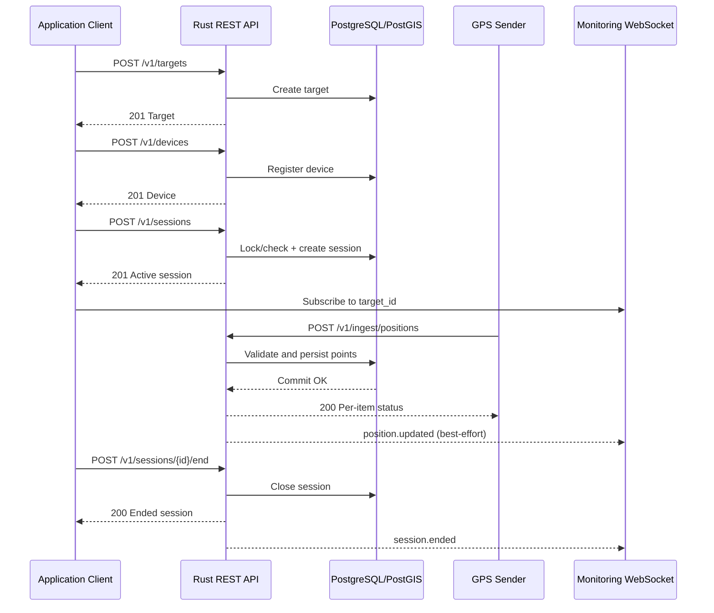

# Generic GPS Tracking Backend — API Contract v1

> **Status:** FINAL — Perencanaan MVP v1.0 (19 Oktober 2026). Final sebagai acuan implementasi; bukan klaim implementasi selesai atau siap produksi.
> **Project:** Generic GPS Tracking Engine  
> **Backend:** Rust · Axum · PostgreSQL/PostGIS  
> **Base URL (contoh):** `https://tracking.example.com/v1`  
> **Versi kontrak:** `v1.0-final`  
> **Tanggal:** 19 Oktober 2026  
> **Dokumen terkait:** `gps-tracking-backend-summary.md`

## 1. Tujuan dan prinsip desain

Dokumen ini adalah **spesifikasi antarmuka** untuk backend GPS tracking general-purpose, **bukan** API untuk manajemen armada atau driver. Sistem tidak mengetahui jenis objek yang sedang dilacak.

- **Target** (`target`): objek abstrak yang ingin dilacak.
- **Device** (`device`): sumber koordinat (aplikasi, IoT, atau GPS hardware).
- **Tracking session** (`session`): relasi target–device selama rentang waktu tertentu.
- **Position** (`position`): koordinat yang dilaporkan **device**; boleh ada di luar sesi jika kebijakan penyimpanan mengizinkan.
- **Protocol adapter**: penerima dan decoder khusus protokol, lalu mengirim **normalized position** ke tracking core.

**Batas arsitektur:** REST/JSON dan WebSocket merupakan kontrak API eksternal; MQTT memakai topic/payload yang didefinisikan di dokumen ini; protokol hardware seperti GT06 dan Teltonika **tidak** memakai kontrak JSON ini secara langsung. Mereka membutuhkan adapter binary dan ACK spesifik perangkat.

### 1.1 Konvensi global

| Area | Kontrak |
|---|---|
| Transport REST | HTTPS, JSON UTF-8 (`Content-Type: application/json`) |
| WebSocket | WSS (`wss://.../v1/ws/tracking`) |
| MQTT | MQTT 3.1.1 atau 5.0 melalui TLS jika device mendukung |
| Penamaan field | `snake_case` |
| ID objek | UUID string |
| Waktu | RFC 3339 / ISO 8601 ber-offset, disimpan sebagai UTC |
| Zona waktu | Waktu response selalu UTC (`Z`) |
| Latitude | `-90` hingga `90` |
| Longitude | `-180` hingga `180` |
| Satuan kecepatan | `speed_mps` (meter/detik) |
| Satuan akurasi / ketinggian | Meter (`accuracy_m`, `altitude_m`) |
| Heading | Derajat `[0, 360)` |
| Pagination | Cursor-based (`limit`, `cursor`, `next_cursor`) |
| Urutan histori | `recorded_at DESC, id DESC` |
| Request tracing | Header `X-Request-Id` pada response |

`recorded_at` adalah waktu posisi diambil oleh perangkat; `received_at` adalah waktu server menerima/memproses posisi. Keduanya tidak dapat dipertukarkan.

### 1.2 Auth dan authorization

Terdapat dua jenis principal:

1. **Application principal** — token aplikasi/pengguna untuk administrasi target/device, session, query, dan WebSocket. Portal memakai cookie sesi HttpOnly + CSRF serta `X-Organization-Id` terverifikasi; integrasi non-browser memakai `Authorization: Bearer <application_token>` dengan tenant/scopes terbatas. Backend menyediakan akun/login internal. Kontrak lengkap: [Management API](./gps-tracking-management-api.md).
2. **Device principal** — token ingestion khusus perangkat. Token terikat ke tepat satu `device_id`, hanya memiliki izin mengirim posisi, dan **bukan** identitas perangkat yang berasal dari payload.

Scope yang digunakan:

| Scope | Izin |
|---|---|
| `targets:read` / `targets:write` | Baca / kelola target |
| `devices:read` / `devices:write` | Baca / kelola device; tidak otomatis memberi izin kredensial |
| `devices:credentials:write` | Terbitkan/rotasi token device yang diizinkan |
| `sessions:read` / `sessions:write` | Baca / mulai/akhiri sesi |
| `positions:read` | Baca lokasi/histori |
| `tracking:subscribe` | Subscribe WebSocket |
| `ingest:write` | Kirim posisi dan heartbeat untuk device yang terikat pada token |

> Otorisasi juga harus memeriksa kepemilikan/akses per objek (tenant wajib sejak MVP), bukan hanya scope token. `identifier` atau IMEI **bukan password**.

### 1.2.1 Tenant dan management

- Setiap target, device, session, dan position dimiliki satu organisasi. `tenant_id` dalam response resource menunjukkan kepemilikan dan wajib tercantum dalam schema OpenAPI.
- Tenant aktif berasal dari konteks autentikasi terverifikasi, bukan klaim bebas dalam body. Client tidak dapat mengubah tenant melalui PATCH. Referensi lintas tenant ditolak tanpa mengungkap data objek lain.
- Peran admin/operator/viewer dan grant objek diterapkan server; scope tidak menggantikan pemeriksaan membership dan grant. Akses target tidak memberi akses seluruh histori device.
- Admin mengelola membership/grant; perubahan `ingestion_policy` ke `always` hanya admin dan diaudit. Transfer device antarorganisasi belum tersedia.
- Token device tetap hanya untuk ingestion satu device dan tenant. Identifier unik per `(tenant_id, protocol, identifier)`.
- Auth management P0 mencakup login/logout, pembaruan/pencabutan token, perubahan password/recovery, serta pengelolaan organisasi/membership/grant. Path, schema, TTL dan error mengikuti Management API; matrix di bawah hanya mencakup API tracking.
- Organisasi dan admin awal dibuat/disiapkan pengelola platform; admin mengundang anggota. Tidak ada registrasi publik atau create organisasi mandiri. Akun dapat memiliki beberapa membership; backend memverifikasi tenant aktif dan tidak menyatukan izin antarorganisasi. Peran platform tidak otomatis memberi izin membaca lokasi. Kontrak undangan/aktivasi/bootstrap ditetapkan pada Management API.
- Sesi autentikasi berbeda dari tracking session. Pencabutan sesi/membership/grant juga menghentikan akses WebSocket aktif yang terdampak.

### 1.2.2 Keamanan login management (P0)

Login email/password dilengkapi MFA wajib untuk pengelola platform, admin organisasi dan operator dengan `devices:credentials:write`; opsional bagi pengguna lain. Kewajiban MFA ditentukan dari seluruh membership akun dan ditegakkan backend. Autentikasi parsial/enrollment tidak boleh menghasilkan sesi penuh yang melewati MFA atau akses istimewa.

Undangan/aktivasi dan reset password memakai tautan email sekali pakai, kedaluwarsa dan dapat dicabut. Recovery MFA memakai kode sekali pakai dengan konsumsi atomik; reset password tidak menghapus MFA. Pengguna dapat melihat/mencabut sesi perangkat lain, termasuk akses WS terkait, tanpa memengaruhi tracking session. TOTP, sesi idle 30 menit/absolute 12 jam, re-auth 5 menit dan recovery operator terverifikasi ditetapkan pada Technical Decisions/Management API. Acceptance mengikuti Portal Spec §3.2.

### 1.2.3 Konsumen portal management (P0)

[Portal Spec](./gps-tracking-portal-spec.md) menetapkan halaman management, peta dan histori. Portal memakai API tracking ini dan [Management API](./gps-tracking-management-api.md) yang sudah ditetapkan. `device_id` adalah identifier, bukan credential. Satu token ingestion aktif per device; secret hanya tersedia saat penerbitan/rotasi. Registrasi tidak otomatis membuat tracking session.

Management API menetapkan tambahan kontrak portal: status aktif device dan aktivasi/penonaktifan, metadata kredensial tanpa secret, organisasi/membership/grant, sesi login dan audit. Penonaktifan menolak ingestion berikutnya tetapi tidak menghapus histori atau otomatis menutup session. Disable atomik mencabut token; reaktivasi memerlukan token baru; schema mengikuti Management API. Semua requirement portal wajib ditegakkan backend.

### 1.3 Respons error standar

```json
{
  "error": {
    "code": "SESSION_CONFLICT",
    "message": "Device already has an active session",
    "details": {
      "device_id": "550e8400-e29b-41d4-a716-446655440002"
    },
    "request_id": "req_01jexample"
  }
}
```

| HTTP status | Kapan digunakan |
|---|---|
| `200 OK` | Data berhasil dibaca, diubah, session ditutup, atau batch ingestion selesai diproses |
| `201 Created` | Target, device, atau session berhasil dibuat |
| `400 Bad Request` | JSON rusak, parameter query malformed, atau format request tidak bisa dibaca |
| `401 Unauthorized` | Credential tidak ada, kedaluwarsa, atau tidak valid |
| `403 Forbidden` | Principal tidak memiliki akses ke sumber daya |
| `404 Not Found` | Resource tidak ditemukan atau sengaja disembunyikan |
| `409 Conflict` | Session bentrok, ID unik bentrok, atau idempotency key dipakai dengan body berbeda |
| `413 Payload Too Large` | Request melewati batas ukuran payload |
| `422 Unprocessable Content` | Field request tidak memenuhi constraint struktural/bisnis |
| `429 Too Many Requests` | Rate limit terpenuhi; gunakan `Retry-After` jika tersedia |
| `500 Internal Server Error` | Error internal tanpa mengekspos informasi rahasia |
| `503 Service Unavailable` | Dependency penting tidak tersedia / server belum siap |

Contoh `error.code`: `VALIDATION_ERROR`, `UNAUTHORIZED`, `FORBIDDEN`, `NOT_FOUND`, `SESSION_CONFLICT`, `DEVICE_CONFLICT`, `IDEMPOTENCY_CONFLICT`, `RATE_LIMITED`, `INTERNAL_ERROR`.

Contoh header bearer application di bawah berlaku untuk integrasi non-browser dengan scope yang sesuai. Portal memakai cookie + CSRF untuk mutation dan `X-Organization-Id`; endpoint credentials/account/membership menolak token integrasi.

## 2. Endpoint matrix

> Semua path di bawah relatif terhadap base URL `/v1` kecuali health check.

| Method | Path | Scope | Deskripsi |
|---|---|---|---|
| `POST` | `/targets` | `targets:write` | Buat target |
| `GET` | `/targets` | `targets:read` | Daftar target |
| `GET` | `/targets/{target_id}` | `targets:read` | Detail target |
| `PATCH` | `/targets/{target_id}` | `targets:write` | Ubah atribut target |
| `GET` | `/targets/{target_id}/location` | `positions:read` | Lokasi terbaru dari sesi aktif target |
| `POST` | `/devices` | `devices:write` | Registrasi device |
| `GET` | `/devices` | `devices:read` | Daftar device |
| `GET` | `/devices/{device_id}` | `devices:read` | Detail device |
| `PATCH` | `/devices/{device_id}` | `devices:write` | Ubah konfigurasi device |
| `POST` | `/devices/{device_id}/credentials/rotate` | `devices:credentials:write` | Rotasi token HTTP ingestion |
| `GET` | `/devices/{device_id}/location` | `positions:read` | Lokasi terbaru berdasarkan device |
| `GET` | `/devices/{device_id}/positions` | `positions:read` | Riwayat posisi device |
| `POST` | `/sessions` | `sessions:write` | Mulai sesi |
| `GET` | `/sessions` | `sessions:read` | Filter/daftar sesi |
| `GET` | `/sessions/{session_id}` | `sessions:read` | Detail sesi |
| `POST` | `/sessions/{session_id}/end` | `sessions:write` | Akhiri sesi |
| `GET` | `/sessions/{session_id}/positions` | `positions:read` | Histori posisi selama sesi |
| `POST` | `/ingest/positions` | `ingest:write` (device principal) | Batch posisi HTTP |
| `POST` | `/ingest/heartbeat` | `ingest:write` (device principal) | Heartbeat tanpa koordinat |
| `POST` | `/realtime/tickets` | `tracking:subscribe` | Tiket WebSocket singkat untuk browser |
| `GET` | `/ws/tracking` | `tracking:subscribe` | Upgrade ke WebSocket |
| `GET` | `/healthz` | Ops/public sesuai deploy | Liveness |
| `GET` | `/readyz` | Ops/privat | Readiness dependency |

**Tidak disediakan pada MVP:** hard-delete target/device/session melalui API publik (delete membership, grant, credential dan login session tetap tersedia), remote control hardware, geofencing, route planning, API khusus kendaraan/driver, dan query perangkat lintas-tenant.

## 3. Resource schema

### 3.1 `Target`

```json
{
  "id": "550e8400-e29b-41d4-a716-446655440001",
  "name": "Operasional A",
  "external_ref": "asset-001",
  "metadata": {
    "department": "internal"
  },
  "created_at": "2026-10-19T02:00:00Z",
  "updated_at": "2026-10-19T02:00:00Z",
  "tenant_id": "550e8400-e29b-41d4-a716-446655440000"
}
```

`name` wajib, 1–150 karakter setelah trim. `external_ref` nullable, 1–128 karakter jika diberikan, unik per tenant untuk nilai non-null (case-sensitive); konflik menghasilkan 409. `metadata` adalah JSON object maksimal 16 KiB UTF-8 setelah serialization compact, default `{}`. Aturan name/metadata juga berlaku pada device; identifier 1–128 karakter, case-sensitive dan immutable.

### 3.2 `Device`

```json
{
  "id": "550e8400-e29b-41d4-a716-446655440002",
  "name": "Tracker-001",
  "protocol": "http-json",
  "identifier": "gps-001",
  "ingestion_policy": "session_only",
  "metadata": {
    "model": "test-device"
  },
  "created_at": "2026-10-19T02:05:00Z",
  "updated_at": "2026-10-19T02:05:00Z",
  "tenant_id": "550e8400-e29b-41d4-a716-446655440000",
  "enabled": true
}
```

- `protocol` adalah identifier adapter, misalnya `http-json`, `mqtt-json`, `gt06`, `teltonika-codec8`. Nilai yang diterima mengikuti daftar adapter yang benar-benar diaktifkan di server.
- `identifier` adalah identitas perangkat di adapter itu; harus unik untuk pasangan (`protocol`, `identifier`) dalam namespace relevan.
- `ingestion_policy` bernilai `session_only` atau `always`; default `session_only`.
- Rahasia autentikasi **tidak** disertakan dalam representasi `Device`.

### 3.3 `TrackingSession`

```json
{
  "id": "550e8400-e29b-41d4-a716-446655440003",
  "target_id": "550e8400-e29b-41d4-a716-446655440001",
  "device_id": "550e8400-e29b-41d4-a716-446655440002",
  "status": "active",
  "started_at": "2026-10-19T03:00:00Z",
  "ended_at": null,
  "created_at": "2026-10-19T03:00:00Z",
  "tenant_id": "550e8400-e29b-41d4-a716-446655440000"
}
```

`status` adalah nilai turunan: `active` jika `ended_at = null`, selain itu `ended`. Waktu start/end ditentukan **server** dalam MVP; klien tidak boleh mengirim `started_at` atau `ended_at` saat membuat sesi.

### 3.4 `Position`

```json
{
  "id": "12937",
  "device_id": "550e8400-e29b-41d4-a716-446655440002",
  "message_id": "1c37d584-cf4b-4d30-8195-7e6bbfe6a31f",
  "latitude": -6.8048,
  "longitude": 110.8419,
  "altitude_m": 28.5,
  "speed_mps": 9.5,
  "heading_deg": 135.0,
  "accuracy_m": 8.5,
  "recorded_at": "2026-10-19T03:00:10Z",
  "received_at": "2026-10-19T03:00:11Z",
  "attributes": {
    "battery_percent": 86,
    "satellites": 12
  },
  "tenant_id": "550e8400-e29b-41d4-a716-446655440000"
}
```

`id` dikembalikan sebagai **string desimal** karena database mungkin memakai BIGINT dan nilai besar tidak aman di semua JavaScript number. `message_id` opsional pada posisi dari protokol hardware legacy. Field posisi opsional lainnya bernilai `null` jika tidak diketahui. `received_at` hanya berasal dari server.

## 4. Targets API

### 4.1 `POST /v1/targets`

**Request**

```http
POST /v1/targets HTTP/1.1
Authorization: Bearer <application_access_token>
Content-Type: application/json

{
  "name": "Operasional A",
  "external_ref": "asset-001",
  "metadata": { "department": "internal" }
}
```

**Response — `201 Created`**

```json
{
  "id": "550e8400-e29b-41d4-a716-446655440001",
  "name": "Operasional A",
  "external_ref": "asset-001",
  "metadata": {
    "department": "internal"
  },
  "created_at": "2026-10-19T02:00:00Z",
  "updated_at": "2026-10-19T02:00:00Z",
  "tenant_id": "550e8400-e29b-41d4-a716-446655440000"
}
```

Header `Location: /v1/targets/{target_id}`.

### 4.2 `GET /v1/targets`

Query: `limit` (default `50`, maksimum `100`), `cursor` (opsional), `q` (pencarian nama opsional).

```json
{
  "data": [
    {
      "id": "550e8400-e29b-41d4-a716-446655440001",
      "name": "Operasional A",
      "external_ref": "asset-001",
      "metadata": {},
      "created_at": "2026-10-19T02:00:00Z",
      "updated_at": "2026-10-19T02:00:00Z",
      "tenant_id": "550e8400-e29b-41d4-a716-446655440000"
    }
  ],
  "next_cursor": null
}
```

### 4.3 `GET /v1/targets/{target_id}` dan `PATCH /v1/targets/{target_id}`

`GET` mengembalikan satu `Target` (`200`). `PATCH` menerima subset field yang dapat diedit: `name`, `external_ref`, `metadata`; kunci lain ditolak (`422`). `metadata` menggantikan JSON object secara utuh, bukan deep merge. Hasil `PATCH` berupa `Target` yang sudah diperbarui (`200`).

### 4.4 `GET /v1/targets/{target_id}/location`

Menampilkan lokasi dari **sesi aktif saat ini**. Jika tidak ada sesi aktif atau belum ada posisi sah sejak sesi dimulai, tidak menggunakan posisi dari sesi sebelumnya.

**Response — `200 OK`**

```json
{
  "target_id": "550e8400-e29b-41d4-a716-446655440001",
  "tracking_status": "active",
  "connectivity_status": "online",
  "position_status": "fresh",
  "session_id": "550e8400-e29b-41d4-a716-446655440003",
  "device_id": "550e8400-e29b-41d4-a716-446655440002",
  "position": {
    "latitude": -6.8048,
    "longitude": 110.8419,
    "speed_mps": 9.5,
    "heading_deg": 135.0,
    "recorded_at": "2026-10-19T03:00:10Z",
    "received_at": "2026-10-19T03:00:11Z",
    "id": "12937"
  },
  "last_contact_at": "2026-10-19T03:00:11Z",
  "tenant_id": "550e8400-e29b-41d4-a716-446655440000",
  "observed_at": "2026-10-19T03:00:12Z"
}
```

`tracking_status` hanya `active|inactive`, berdasarkan ada/tidaknya sesi aktif. `connectivity_status` adalah `online|offline|unknown|null`; `position_status` adalah `fresh|stale|no_position`. Saat `inactive`, identitas sesi/device, posisi, `last_contact_at` dan connectivity bernilai `null`, dengan `position_status = no_position`. Saat `active`, status konektivitas mengikuti device sesi aktif meskipun belum ada posisi. Posisi tetap hanya dari interval sesi aktif. Definisi status mengikuti §7.4; heartbeat tidak membuat posisi baru.

## 5. Devices API

### 5.1 `POST /v1/devices`

```http
POST /v1/devices HTTP/1.1
Authorization: Bearer <application_access_token>
Content-Type: application/json

{
  "name": "Tracker-001",
  "protocol": "http-json",
  "identifier": "gps-001",
  "ingestion_policy": "session_only",
  "metadata": { "model": "test-device" }
}
```

**Response — `201 Created`:** objek `Device` (schema §3.2), **tanpa credential**. Pembuatan kredensial dilakukan eksplisit melalui endpoint rotasi/provisioning agar lifecycle secret jelas.

### 5.2 `GET /v1/devices`, `GET /v1/devices/{device_id}`, `PATCH /v1/devices/{device_id}`

- `GET /devices` menggunakan `limit`, `cursor`, `protocol` (opsional), `q` (opsional); response `{ "data": [...], "next_cursor": null }`.
- `GET /devices/{id}` mengembalikan satu `Device` (`200`).
- `PATCH /devices/{id}` menerima `name`, `metadata`, `ingestion_policy`, `enabled`. Pada MVP, `protocol` dan `identifier` **immutable** untuk mencegah perubahan identitas perangkat secara diam-diam; migrasi identitas ditangani lewat workflow terpisah.
- Mengubah `ingestion_policy` memengaruhi **pesan baru**, bukan menghapus histori secara otomatis.

### 5.3 `POST /v1/devices/{device_id}/credentials/rotate`

Khusus `http-json` (MVP). Membuat token ingestion baru, menyimpan hanya hash token, dan mencabut token lama **secara atomik**. Operasi ini berdampak pada device, sehingga memerlukan `devices:credentials:write` serta akses objek device. Admin organisasi memiliki izin ini; operator memerlukan grant eksplisit. Cookie portal membutuhkan recent auth; application integration token ditolak untuk endpoint kredensial.

**Request:** body `{}`.

**Response — `200 OK`**

```json
{
  "device_id": "550e8400-e29b-41d4-a716-446655440002",
  "token": "gps_live_REDACTED_EXAMPLE",
  "created_at": "2026-10-19T02:10:00Z"
}
```

`token` hanya dikembalikan **satu kali** dan harus disimpan secara aman oleh klien. Contoh token di atas bukan credential nyata. Endpoint ini **tidak berlaku** sebagai pengganti auth pada GT06/Teltonika, karena mekanisme auth hardware tergantung adapter.

### 5.4 `GET /v1/devices/{device_id}/location`

Response `{ "device_id": "...", "connectivity_status": "online|offline|unknown", "position_status": "fresh|stale|no_position", "position": <Position|null>, "last_contact_at": <timestamp|null> }`. Status session tersedia pada resource session, bukan digabung dalam status konektivitas device.

Memakai posisi terakhir yang **disimpan** untuk device ini. Dalam `session_only`, posisi di luar session tidak disimpan dan tidak tersedia melalui endpoint ini. Dalam `always`, posisi dapat tersedia tanpa sesi.

### 5.5 `GET /v1/devices/{device_id}/positions`

**Query**

```http
GET /v1/devices/550e8400-e29b-41d4-a716-446655440002/positions?from=2026-10-19T03%3A00%3A00Z&to=2026-10-19T04%3A00%3A00Z&limit=100
```

- `from` (opsional, inklusif), `to` (opsional, eksklusif), format RFC 3339. Jika to omitted gunakan now, jika from omitted gunakan to - 24h. Rentang harus positif dan maksimal 31 hari, selain itu 422.
- `limit`: default `100`, max `1000`.
- `cursor`: opaque string dari `next_cursor`, jangan dibuat sendiri oleh klien.
- Filter waktu menggunakan `recorded_at`, hasil terbaru lebih dulu.

**Response — `200 OK`**

```json
{
  "data": [
    {
      "id": "12937",
      "device_id": "550e8400-e29b-41d4-a716-446655440002",
      "message_id": "1c37d584-cf4b-4d30-8195-7e6bbfe6a31f",
      "latitude": -6.8048,
      "longitude": 110.8419,
      "altitude_m": null,
      "speed_mps": 9.5,
      "heading_deg": 135.0,
      "accuracy_m": 8.5,
      "recorded_at": "2026-10-19T03:00:10Z",
      "received_at": "2026-10-19T03:00:11Z",
      "attributes": {},
      "tenant_id": "550e8400-e29b-41d4-a716-446655440000"
    }
  ],
  "next_cursor": null
}
```

## 6. Tracking Sessions API

### 6.1 `POST /v1/sessions`

Membuat session aktif baru. `target_id` dan `device_id` wajib. `Idempotency-Key` (wajib, opaque string 1–128 karakter, missing/invalid -> 400) memungkinkan retry request start tanpa membuat sesi ganda.

```http
POST /v1/sessions HTTP/1.1
Authorization: Bearer <application_access_token>
Idempotency-Key: 2475d184-262e-42e2-b249-31b84986f1d7
Content-Type: application/json

{
  "target_id": "550e8400-e29b-41d4-a716-446655440001",
  "device_id": "550e8400-e29b-41d4-a716-446655440002"
}
```

**Response — `201 Created`**

```json
{
  "id": "550e8400-e29b-41d4-a716-446655440003",
  "target_id": "550e8400-e29b-41d4-a716-446655440001",
  "device_id": "550e8400-e29b-41d4-a716-446655440002",
  "status": "active",
  "started_at": "2026-10-19T03:00:00Z",
  "ended_at": null,
  "created_at": "2026-10-19T03:00:00Z",
  "tenant_id": "550e8400-e29b-41d4-a716-446655440000"
}
```

Aturan:

1. Target dan device harus ada serta dapat diakses oleh principal.
2. Maksimal **satu sesi aktif per target** dan **satu sesi aktif per device**.
3. Rentang sesi historis dari device yang sama **tidak boleh overlap**. Karena waktu sesi ditentukan server dan sesi baru tidak dapat backdate pada MVP, aturan ini dapat ditegakkan bersama locking/constraint di database.
4. Jika target/device masih punya sesi aktif lain, kembalikan `409 SESSION_CONFLICT`.
5. Retry dengan `Idempotency-Key` dan body sama mengembalikan hasil operasi asli (termasuk status `201` selama cache idempotency masih berlaku); key sama dengan body berbeda → `409 IDEMPOTENCY_CONFLICT`.
6. Simpan idempotency key 24 jam, scoped per tenant + principal + endpoint. Replay tetap memeriksa izin terkini sebelum mengembalikan respons tersimpan. Setelah TTL habis, key dianggap request baru dan constraint session tetap berlaku.
7. Membuat session **tidak** mengirim start command ke GPS hardware.

### 6.2 `GET /v1/sessions` dan `GET /v1/sessions/{session_id}`

`GET /sessions` mendukung `target_id`, `device_id`, `status=active|ended`, `from`, `to`, `limit`, `cursor`. `from`/`to` memfilter `started_at` (inklusif/eksklusif). Pagination sama dengan endpoint lainnya.

```json
{
  "data": [
    {
      "id": "550e8400-e29b-41d4-a716-446655440003",
      "target_id": "550e8400-e29b-41d4-a716-446655440001",
      "device_id": "550e8400-e29b-41d4-a716-446655440002",
      "status": "active",
      "started_at": "2026-10-19T03:00:00Z",
      "ended_at": null,
      "created_at": "2026-10-19T03:00:00Z",
      "tenant_id": "550e8400-e29b-41d4-a716-446655440000"
    }
  ],
  "next_cursor": null
}
```

`GET /sessions/{id}` mengembalikan satu objek `TrackingSession` (`200`).

### 6.3 `POST /v1/sessions/{session_id}/end`

**Request:** `{}`.

**Response — `200 OK`**

```json
{
  "id": "550e8400-e29b-41d4-a716-446655440003",
  "target_id": "550e8400-e29b-41d4-a716-446655440001",
  "device_id": "550e8400-e29b-41d4-a716-446655440002",
  "status": "ended",
  "started_at": "2026-10-19T03:00:00Z",
  "ended_at": "2026-10-19T04:00:00Z",
  "created_at": "2026-10-19T03:00:00Z",
  "tenant_id": "550e8400-e29b-41d4-a716-446655440000"
}
```

Aturan:

- `ended_at` ditentukan server; bersifat idempotent: panggilan kedua mengembalikan sesi yang sudah ditutup dengan `ended_at` semula, bukan mengubahnya.
- Posisi hardware setelah akhir sesi tidak lagi diasosiasikan ke target tersebut.
- Posisi yang **direkam saat sesi berlangsung** namun diterima terlambat tetap boleh masuk histori sesuai kebijakan keterlambatan (§8).
- Penutupan sesi dan ingestion yang bersamaan harus menggunakan transaksi/locking yang konsisten agar tidak terjadi kondisi balapan.

### 6.4 `GET /v1/sessions/{session_id}/positions`

Parameter `from`, `to`, `limit`, `cursor` sama seperti riwayat device. Hasil merupakan **intersection** antara filter waktu dan interval sesi `[started_at, ended_at)` (jika aktif, batas akhir tidak dibatasi). Data dipilih dari `positions` dengan `device_id` yang sama dan `recorded_at` berada dalam interval tersebut.

Response: `{ "data": [<Position>, ...], "next_cursor": <string|null> }`. Endpoint ini membaca histori; tidak membuat salinan posisi tersendiri untuk session.

## 7. HTTP GPS Ingestion

### 7.1 `POST /v1/ingest/positions`

Endpoint **khusus device principal**, bukan token admin. Hanya `device_id` yang terikat pada token diperbolehkan. Batas awal MVP: **1–100 titik per request** dan payload maksimal **256 KiB** (konfigurabel).

```http
POST /v1/ingest/positions HTTP/1.1
Authorization: Bearer <device_ingest_token>
Content-Type: application/json

{
  "device_id": "550e8400-e29b-41d4-a716-446655440002",
  "points": [
    {
      "message_id": "1c37d584-cf4b-4d30-8195-7e6bbfe6a31f",
      "latitude": -6.8048,
      "longitude": 110.8419,
      "altitude_m": 28.5,
      "speed_mps": 9.5,
      "heading_deg": 135.0,
      "accuracy_m": 8.5,
      "recorded_at": "2026-10-19T03:00:10Z",
      "attributes": {
        "battery_percent": 86,
        "satellites": 12
      }
    },
    {
      "message_id": "46d96234-c548-4adc-88d0-6c09da67236e",
      "latitude": -6.8051,
      "longitude": 110.8423,
      "recorded_at": "2026-10-19T03:00:20Z",
      "attributes": {}
    }
  ]
}
```

**Response — `200 OK`:** pemrosesan **sinkron**; titik `stored` sudah commit ke penyimpanan sebelum respons sukses diberikan.

```json
{
  "device_id": "550e8400-e29b-41d4-a716-446655440002",
  "summary": {
    "received": 2,
    "stored": 2,
    "duplicate": 0,
    "rejected": 0
  },
  "results": [
    {
      "index": 0,
      "message_id": "1c37d584-cf4b-4d30-8195-7e6bbfe6a31f",
      "status": "stored",
      "position_id": "12937"
    },
    {
      "index": 1,
      "message_id": "46d96234-c548-4adc-88d0-6c09da67236e",
      "status": "stored",
      "position_id": "12938"
    }
  ]
}
```

Aturan hasil per item:

| `status` | Makna |
|---|---|
| `stored` | Titik berhasil disimpan, `position_id` tersedia |
| `duplicate` | `message_id` sudah pernah diproses untuk device yang sama; tidak menambah baris baru |
| `rejected` | Titik bermasalah secara semantik atau di luar kebijakan penyimpanan; `reason` tersedia |

Contoh item ditolak:

```json
{
  "index": 3,
  "message_id": "9a8e68f4-2b99-494d-a080-b74ae210be43",
  "status": "rejected",
  "reason": "OUTSIDE_SESSION"
}
```

Kemungkinan `reason`: `OUTSIDE_SESSION`, `INVALID_COORDINATES`, `INVALID_MEASUREMENT`, `TIMESTAMP_TOO_OLD`, `TIMESTAMP_IN_FUTURE`, `ATTRIBUTES_TOO_LARGE`, `MESSAGE_ID_CONFLICT`, `TIMESTAMP_NOT_READY`.

**Semantik batch:** validasi struktur request dan otorisasi dilakukan pada seluruh request (`400/401/403/422`); setiap titik yang bentuk datanya valid kemudian dievaluasi terpisah. Permintaan dapat menghasilkan campuran `stored`, `duplicate`, dan `rejected` dalam `200 OK`. Jika transaksi/database gagal, respons `5xx` dan klien boleh mengirim ulang dengan `message_id` sama. `message_id` wajib pada HTTP/MQTT (UUID atau opaque string unik; maksimum 128 karakter). Implementasi harus menggunakan unique index `(device_id, message_id)` untuk deduplikasi yang aman terhadap concurrency.

### 7.1.1 Pengiriman adaptif

Client mengirim berdasarkan pergerakan; kontrak tidak mewajibkan interval posisi tetap. Batas batch, timestamp, deduplikasi dan session tetap berlaku. Diamnya device bukan alasan menolak posisi berikutnya yang valid atau otomatis mengakhiri session.

Heartbeat tanpa koordinat masuk MVP (§7.4). Status konektivitas dan kesegaran posisi dipisahkan; device diam dapat tetap online dengan posisi lama.

### 7.2 Validasi posisi

| Field | Wajib | Aturan |
|---|---|---|
| `message_id` | Ya (HTTP/MQTT) | String unik per device, 1–128 karakter |
| `latitude` | Ya | Number finite, `[-90, 90]` |
| `longitude` | Ya | Number finite, `[-180, 180]` |
| `recorded_at` | Ya | Waktu valid RFC 3339 |
| `altitude_m` | Tidak | Number finite |
| `speed_mps` | Tidak | Number finite, ≥ 0 |
| `heading_deg` | Tidak | Number finite, `[0, 360)` |
| `accuracy_m` | Tidak | Number finite, ≥ 0 |
| `attributes` | Tidak | JSON object, default `{}`, maksimal 4 KiB (awal) |

**Default kebijakan MVP (disepakati):** `max_future_skew = 2 menit`, `max_late_arrival = 24 jam`, `position_freshness_timeout = 60 detik` (nilai awal teknis, bukan interval wajib pengiriman). Ini adalah **baseline MVP yang disepakati**, bukan spesifikasi hardware. Ukur keterlambatan terhadap waktu penerimaan server (`received_at - recorded_at`). Timestamp di luar kebijakan ditolak dengan alasan relevan. Semua timestamp harus dinormalisasi UTC.

Untuk `session_only`, timestamp di depan `received_at` tetapi masih dalam 2 menit menghasilkan `rejected / TIMESTAMP_NOT_READY`, `retryable: true`, dan `retry_after_ms` (selisih waktu dibulatkan ke atas). Titik belum disimpan; sender mengirim ulang payload dan ID yang sama setelah waktunya tercapai. Backend kembali memeriksa sesi final dan dapat menolak dengan `OUTSIDE_SESSION` bila sesi sudah berakhir sebelum waktu rekam. Timestamp lebih dari 2 menit di depan menghasilkan `TIMESTAMP_IN_FUTURE`. Untuk `always`, timestamp dalam toleransi dapat disimpan langsung.

### 7.3 Semantik penyimpanan

- `session_only`: titik disimpan **jika dan hanya jika** `recorded_at` berada di salah satu sesi sah milik device dan memenuhi batas late-arrival. Hal ini tetap berlaku untuk sesi yang baru saja ditutup (backfill dalam jendela toleransi). Titik di luar sesi → `rejected / OUTSIDE_SESSION`.
- `always`: titik valid disimpan meski device tidak memiliki sesi.
- Interval session adalah **`[started_at, ended_at)`** (awal inklusif, akhir eksklusif); sesi aktif tidak memiliki batas akhir sampai ditutup.
- Sesi baru tidak boleh di-backdate pada MVP. Event historis tidak boleh mengubah `started_at`/`ended_at`.
- Setelah autentikasi dan validasi struktur, pesan tersimpan diperiksa sebelum batas waktu/policy dievaluasi ulang: payload identik menghasilkan `duplicate`, payload berbeda `MESSAGE_ID_CONFLICT`. Duplikasi tidak menerbitkan event atau memperbarui retensi/`received_at`.
- Posisi dengan `recorded_at` lebih lama dari titik terbaru yang tersimpan **tidak menggantikan** lokasi live.
- Satu `message_id` yang sama dengan isi berbeda harus diperlakukan sebagai konflik identitas pesan dan dicatat untuk audit; jangan diam-diam menganggap payload berubah sebagai data baru. Untuk MVP boleh mengembalikan status per-item `rejected` dengan `reason = MESSAGE_ID_CONFLICT`.
- `received_at` merupakan waktu server; jam perangkat dapat bergeser dan tidak boleh dipercaya mutlak.

**Catatan operasional:** pola `session_only` dapat menyebabkan data valid sebelum start session tidak tersimpan, meskipun perangkat mengirimnya. Ini perilaku yang disengaja. Jika ingin merekam pergerakan terus-menerus gunakan `always` dengan kebijakan privasi/retensi yang sesuai.

### 7.4 `POST /v1/ingest/heartbeat` — P0

**Cakupan dan default waktu disepakati:** heartbeat terautentikasi tanpa koordinat, cadence 60 detik jika tidak ada ingestion yang berhasil, timeout offline 180 detik. Endpoint berikut menjadi rancangan kontrak implementasi.

Request memakai bearer device token yang sama dengan ingestion posisi, scope `ingest:write`, `Content-Type: application/json`, dan body `{}`. Device/tenant berasal dari token. Field tambahan termasuk koordinat, timestamp client dan device ID ditolak. Device nonaktif atau token dicabut ditolak dan tidak memperbarui kontak.

Response `200 OK` setelah update kontak commit:

```json
{
  "device_id": "550e8400-e29b-41d4-a716-446655440002",
  "last_contact_at": "2026-10-19T03:00:11Z",
  "connectivity_status": "online"
}
```

- Server menetapkan waktu penerimaan dalam UTC; `last_contact_at` diperbarui monotonik. Simpan nilai terakhir pada device, bukan baris histori heartbeat untuk setiap request.
- Heartbeat diterima tanpa tracking session dan pada `session_only`, tetapi tidak membuat position, mengubah `recorded_at`/`received_at` posisi, memulai/memperpanjang/mengakhiri session atau memperpanjang retensi lokasi.
- HTTP position batch yang terautentikasi, lolos struktur dan selesai diproses juga memperbarui kontak server, termasuk batch duplikat/backfill atau semua item rejected secara semantik. Komunikasi tersebut membuktikan kontak saat ini, bukan freshness posisi. Error autentikasi/struktur atau transaksi gagal tidak memperbarui kontak.
- Retry heartbeat aman: hanya memperbarui kontak terakhir tanpa menambah histori lokasi. Endpoint memakai batas ukuran, rate limit dan request ID; tidak membuat audit row per heartbeat normal.
- Default MVP disepakati dan konfigurabel: heartbeat setiap 60 detik selama device aktif jika tidak ada komunikasi ingestion yang berhasil; offline ketika umur kontak mencapai 180 detik. Kontak ingestion yang berhasil menghitung ulang jeda heartbeat. Angka ini terpisah dari interval posisi adaptif; kegagalan request tidak menunda heartbeat berdasarkan anggapan kontak berhasil.
- `connectivity_status = unknown` bila belum pernah ada kontak; `online` bila umur kontak < timeout; `offline` bila umur kontak >= timeout. Status ini berarti kontak terakhir dengan kredensial device, bukan bukti transport masih tersambung atau GPS memiliki fix.
- `position_status = no_position` bila tidak ada posisi yang dapat ditampilkan sesuai sesi/retensi; selain itu `fresh` jika `max(0, now - recorded_at)` < freshness timeout, dan `stale` bila >=. Posisi lama yang diunggah ulang/heartbeat tidak mengubahnya. `stale` menyatakan usia sampel, bukan kepastian lokasi sekarang salah.
- Snapshot REST menghitung status pada saat dibaca. Worker timeout menghasilkan event perubahan status tanpa menunggu request berikutnya; setelah restart baca timestamp terakhir dari DB dan hitung ulang. Event boleh best-effort, snapshot tetap otoritatif.

## 8. Real-time WebSocket

### 8.1 Koneksi dan autentikasi

Endpoint: `GET /v1/ws/tracking` dengan HTTP Upgrade; setelah terhubung, pesan berupa JSON UTF-8.

- Klien non-browser dapat memakai header `Authorization: Bearer <application_access_token>` ketika handshake.
- Browser memakai cookie sesi, CSRF dan header organisasi saat `POST /v1/realtime/tickets`, lalu tiket singkat pada URL WSS. Browser tidak memakai application bearer token di localStorage.

**Mintakan tiket (contoh integrasi non-browser; portal menggunakan cookie/CSRF/tenant header):**

```http
POST /v1/realtime/tickets HTTP/1.1
Authorization: Bearer <application_access_token>
Content-Type: application/json

{}
```

**Response — `200 OK`**

```json
{
  "ticket": "ws_ticket_REDACTED_EXAMPLE",
  "expires_at": "2026-10-19T03:01:00Z"
}
```

Tiket berumur maksimal 60 detik, **single-use**, terikat ke principal, dan hanya sah untuk WebSocket. Jangan memasukkan access token utama ke URL. Proteksi/tutupi query string tiket di access log.

```text
wss://tracking.example.com/v1/ws/tracking?ticket=<ephemeral_ws_ticket>
```

Saat upgrade, server memverifikasi `tracking:subscribe`; subscription selanjutnya hanya boleh memakai resource yang diizinkan. Untuk browser, validasi `Origin` juga diperlukan sesuai daftar origin yang diizinkan.

### 8.2 Subscribe

Klien mengirim:

```json
{
  "type": "subscribe",
  "request_id": "sub-001",
  "target_ids": [
    "550e8400-e29b-41d4-a716-446655440001"
  ],
  "device_ids": []
}
```

Server mengirim acknowledgment:

```json
{
  "type": "subscribed",
  "request_id": "sub-001",
  "target_ids": [
    "550e8400-e29b-41d4-a716-446655440001"
  ],
  "device_ids": []
}
```

Semantik subscription:

- Panggilan `subscribe` **mengganti** set subscription sebelumnya pada koneksi tersebut.
- Maksimum 100 ID gabungan per koneksi sebagai default MVP (konfigurabel).
- Jika ada ID yang tidak dapat diakses, server mengirim `type: "error"` dan **tidak mengubah** subscription sebelumnya.
- Setelah `subscribed`, klien dianjurkan mengambil snapshot awal via REST; WebSocket **tidak** menjamin replay event saat terputus.

### 8.3 Event server

Setiap event status juga membawa `observed_at` (UTC saat state dihitung). Snapshot lokasi membawa `observed_at` dan position ID sebagai string bila ada. Konsumen tidak menimpa state baru dengan event/snapshot lama; scope tenant/session wajib cocok.

**`position.updated`** — ketika suatu posisi baru benar-benar memajukan latest location, bukan setiap backfill lama:

```json
{
  "type": "position.updated",
  "event_id": "d74abf3e-8ef0-4555-b5b4-2d319de39d35",
  "emitted_at": "2026-10-19T03:00:11Z",
  "data": {
    "device_id": "550e8400-e29b-41d4-a716-446655440002",
    "target_id": "550e8400-e29b-41d4-a716-446655440001",
    "session_id": "550e8400-e29b-41d4-a716-446655440003",
    "position": {
      "id": "12937",
      "latitude": -6.8048,
      "longitude": 110.8419,
      "recorded_at": "2026-10-19T03:00:10Z",
      "received_at": "2026-10-19T03:00:11Z"
    }
  }
}
```

Jika device memakai `always` dan tidak memiliki session yang sesuai, `target_id`/`session_id` bernilai `null`. Event terkait **target** hanya dikirim kepada subscriber target jika posisi itu termasuk **sesi aktif target saat event diterbitkan**; event terkait device dapat tetap diteruskan kepada subscriber device sesuai hak akses.

**`session.started`**

```json
{
  "type": "session.started",
  "event_id": "6f06f73d-8e52-4727-b567-3b82edbe75bf",
  "emitted_at": "2026-10-19T03:00:00Z",
  "data": {
    "session_id": "550e8400-e29b-41d4-a716-446655440003",
    "target_id": "550e8400-e29b-41d4-a716-446655440001",
    "device_id": "550e8400-e29b-41d4-a716-446655440002"
  }
}
```

**`session.ended`** memakai struktur sama dengan tambahan `ended_at`. **`tracking.status_changed`** memakai `{ "target_id": "...", "device_id": "...", "tracking_status": "active|inactive" }` sebagai `data`.

**`device.connectivity_changed`** memakai `{ "device_id": "...", "connectivity_status": "online|offline|unknown", "last_contact_at": "..." }`; **`position.status_changed`** memakai `{ "device_id": "...", "target_id": null, "session_id": null, "position_status": "fresh|stale|no_position" }` (ID target/session diisi untuk konteks target). Keduanya memakai envelope event yang sama. Heartbeat hanya memicu event connectivity jika status berubah, bukan `position.updated`. Event device memerlukan izin device; subscriber target hanya menerima proyeksi pada sesi aktif yang sah, dengan target/session ID dan tanpa data target lain. Perubahan session/retensi juga mengevaluasi ulang status posisi. Definisi ini menggantikan status gabungan online/offline versi draft sebelumnya.

- Server boleh mengirim WebSocket ping berkala; klien harus menjawab pong sesuai standar WebSocket.
- Jika koneksi terputus, klien reconnect, subscribe ulang, dan fetch snapshot REST.
- MVP: pengiriman event **best-effort** (tanpa guarantee exactly-once/ordered delivery lintas reconnect). Jangan gunakan WebSocket sebagai sumber kebenaran penyimpanan.

## 9. MQTT ingestion contract (fase berikutnya)

> **Catatan:** MQTT adalah standar transport/message broker, tetapi **topic/payload di bagian ini adalah konvensi internal produk**, bukan standar payload lokasi seluruh merek GPS tracker.

**Topic publish**

```text
tracking/v1/devices/{device_id}/positions
```

**Payload** (satu posisi per publish untuk menjaga kesederhanaan adapter awal):

```json
{
  "message_id": "0c805749-b74f-4776-b5dd-634a5815746d",
  "latitude": -6.8048,
  "longitude": 110.8419,
  "speed_mps": 9.5,
  "heading_deg": 135.0,
  "recorded_at": "2026-10-19T03:00:10Z",
  "attributes": {
    "battery_percent": 86
  }
}
```

**Aturan MQTT:**

1. Broker mengautentikasi device dan menerapkan ACL sehingga device hanya dapat publish ke topic miliknya; backend tetap memverifikasi pemetaan principal/topic ke `device_id`.
2. Gunakan QoS 1 untuk *at-least-once delivery* bila didukung; duplikasi ditangani oleh `message_id`.
3. MQTT PUBACK **bukan bukti** data telah commit ke database backend jika broker dan tracking engine terpisah; jangan menjanjikan exactly-once database persistence dari QoS saja.
4. Retained message untuk posisi real-time **tidak direkomendasikan** sebagai default ingestion, agar posisi lama tidak diperlakukan sebagai sampel baru setelah subscribe ulang. Bila digunakan, perlu kebijakan eksplisit.
5. Seluruh validasi dan kebijakan sesi pada HTTP (§7) juga berlaku setelah pesan MQTT dinormalisasi.
6. Topic/format dapat diperluas melalui versi baru; perubahan breaking tidak dilakukan diam-diam pada `tracking/v1`.

## 10. Hardware TCP/UDP adapters (kontrak boundary)

Device tracker hardware komersial dapat menggunakan **GT06 family**, **Teltonika Codec 8/8E**, atau protokol lain. Mereka **tidak** diharapkan mengirim request REST atau JSON MQTT yang didefinisikan di atas kecuali perangkatnya memang mendukung konfigurasi tersebut.

Setiap adapter wajib:

1. Menerima koneksi/packet dengan transport, port, framing, dan timeout sesuai **varian protokol + firmware yang didukung**.
2. Mengidentifikasi device ke record `devices` berdasarkan `(tenant_id, protocol, identifier)` dengan tenant ditentukan dari provisioning/listener tepercaya, bukan identifier bebas; jangan menyamakan identifier/IMEI dengan bukti autentikasi kriptografis.
3. Mendecode koordinat, timestamp, satuan kecepatan, dan data vendor lalu menormalisasikan nilai ke schema posisi internal.
4. Menghubungkan informasi message sequence/record ID ke `message_id` yang stabil **jika protokol menyediakannya**; jika tidak, deduplikasi menjadi best-effort dan dicatat sebagai keterbatasan.
5. Menyerahkan normalized position ke tracking core dengan aturan validasi, session, dan storage yang sama.
6. Mengirim ACK/response yang **tepat menurut protokol hardware**. Aturan kapan mengirim ACK harus mempertimbangkan apakah data sudah diterima secara aman; format ACK tidak disamakan antaradapter.
7. Menerapkan ukuran paket maksimum, pembatasan koneksi, timeouts, rate limiting, dan network allowlisting apabila sesuai.

**Status dukungan:** adapter HTTP tersedia pada MVP; MQTT, GT06, dan Teltonika adalah **rencana implementasi**, bukan klaim bahwa semua tracker dari merek tersebut langsung kompatibel.

## 11. Perilaku konsistensi dan edge cases

| Situasi | Perilaku yang wajib |
|---|---|
| Dua klien start session untuk device sama bersamaan | Tepat satu berhasil, yang lain `409 SESSION_CONFLICT`; tegakkan di DB |
| Start request diulang karena timeout | `Idempotency-Key` mengembalikan sesi yang sama |
| End session dipanggil dua kali | Selalu kembalikan `ended_at` yang pertama |
| HTTP/MQTT posisi yang sama dikirim ulang | `duplicate`, tidak menggandakan data atau event |
| `message_id` sama, isi berbeda | Tolak (`MESSAGE_ID_CONFLICT`), audit |
| Internet device putus, batch dikirim belakangan | Simpan jika timestamp dan kebijakan late-arrival valid |
| Batch lama setelah lokasi baru | Simpan histori valid; jangan memundurkan lokasi terbaru |
| Titik terekam sebelum start session | Tidak masuk histori target session itu |
| Titik terekam tepat saat end session | Tidak termasuk interval sesi yang telah ditutup (`[start, end)`) |
| Device tetap mengirim setelah sesi berakhir | `session_only`: reject jika di luar sesi; `always`: simpan tanpa target |
| Driver/konteks bisnis tidak dikenal | Tidak menjadi field/aturan core tracking |
| Device offline tetapi sesi masih aktif | `connectivity_status = offline`, `session.status = active` |
| Client WS reconnect | Subscribe ulang dan ambil snapshot REST |
| Data IMEI spoofed pada TCP legacy | Jangan klaim perangkat terautentikasi kuat; terapkan kontrol kompensasi |

**Catatan concurrency:** satu jalur serialization/locking perlu dipakai oleh transaksi create/end session dan ingestion terkait. Deduplikasi dan pemutakhiran latest-position harus tahan race, termasuk saat beberapa packet masuk hampir bersamaan.

## 12. Pagination, caching, rate limit, dan observability

### 12.1 Pagination

```json
{
  "data": [],
  "next_cursor": "eyJleGFtcGxlIjoiY3Vyc29yIn0"
}
```

`next_cursor = null` berarti tidak ada halaman berikutnya. Cursor adalah opaque dan harus mengikat sort order serta filter untuk menghindari hasil ambigu. Query histori disortir berdasarkan `recorded_at DESC, id DESC`. Hasil yang masuk bersamaan dapat berubah antarhalaman; bila butuh snapshot konsisten, diperlukan mekanisme snapshot/cutoff tersendiri pada fase lanjut.

### 12.1.1 Retensi posisi

Posisi kedaluwarsa pada `recorded_at + interval '1 year'` dalam UTC (satu tahun kalender; 29 Februari menjadi 28 Februari tahun berikutnya). Seluruh query lokasi/histori mengecualikan posisi kedaluwarsa meski purge belum berjalan. Worker P0 menghapus secara bertahap minimal setiap jam. Jika tidak ada posisi tersisa, endpoint lokasi menggunakan semantik tanpa posisi. Batas late-arrival tetap 24 jam, terpisah dari retensi satu tahun. Restore wajib melakukan purge sebelum data tersedia kembali; retensi backup recovery window 30 hari (dependency maksimal 37 hari) dan audit 365 hari mengikuti Database & Operations.

### 12.2 Rate limiting (angka awal, konfigurabel)

- Endpoint admin/query: per principal, berdasarkan kebutuhan integrasi.
- Ingestion HTTP: maksimal 100 titik/request dan 256 KiB/request.
- WebSocket: maksimal 100 subscription IDs/koneksi.
- MQTT/TCP: batas koneksi, ukuran frame, jumlah pesan/detik per device/adapter.

Angka ini **bukan** kapasitas terjamin; tetapkan target p95 latency dan throughput melalui load test, bukan asumsi.

### 12.3 Request tracing

- Setiap response API mengandung `X-Request-Id`.
- Simpan audit terstruktur untuk pembuatan target/device, rotasi token, start/end sesi, kegagalan autentikasi, dan penolakan posisi.
- Jangan mencatat token, tiket WebSocket, atau riwayat koordinat mentah ke log yang dapat diakses sembarang orang.
- Health check operasional: `/healthz` untuk liveness, `/readyz` untuk kesiapan koneksi dependency (sebaiknya privat di deployment produksi).

## 13. Contoh alur integrasi end-to-end



## 14. Definition of Done — API MVP

- [ ] Heartbeat tanpa sesi, token invalid/nonaktif, retry/concurrency, timeout/restart serta pemisahan connectivity/freshness teruji.

- [ ] Kontrak dan implementasi akun/login internal, management organisasi/membership/grant, serta recovery selesai.
- [ ] Cross-tenant access, pencabutan sesi/grant, dan penghentian akses WS terkait teruji.
- [ ] Retensi satu tahun teruji termasuk tahun kabisat, expiry filter, purge, dan restore.
- [ ] Future-skew retry pada `session_only` teruji terhadap penutupan session dan payload retry identik.

- [ ] REST routes sesuai matrix endpoint dan JSON schema terdokumentasi.
- [ ] Verifikasi scope + object-level authorization pada semua endpoint.
- [ ] Credential device tidak pernah diekspos kecuali saat provisioning/rotasi.
- [ ] DB constraint mencegah active session ganda per target/device.
- [ ] Session start/end tahan concurrent requests dan retry.
- [ ] HTTP batch ingestion menerima 1–100 posisi, dengan validasi serta hasil per item.
- [ ] Deduplikasi by `(device_id, message_id)` aman terhadap request concurrent.
- [ ] `session_only` dan `always` teruji termasuk backfill pasca end session.
- [ ] Query histori dengan filter waktu, cursor, dan sorting deterministik.
- [ ] Last-known position tidak mundur akibat data terlambat.
- [ ] WebSocket authorized, memiliki subscription filtering, reconnect strategy.
- [ ] Security tests: cross-device ingestion, cross-object access, token replay, rate limits.
- [ ] Automated tests: negative coordinates, bad timestamps, duplicate IDs, batas sesi.
- [ ] OpenAPI 3.1 spec dapat dihasilkan atau ditulis berdasarkan kontrak ini.

## 15. Keputusan yang sengaja ditunda

1. Federasi identity provider eksternal (akun/login internal adalah P0; detail kontraknya wajib selesai sebelum implementasi auth).
2. Kuota lanjutan per organisasi (multi-tenancy sudah P0).
3. Bulk export dan anonimisasi; retensi posisi satu tahun serta purge otomatis sudah P0. Retensi backup/audit telah ditetapkan pada Database & Operations.
4. Timestamp correction untuk device dengan clock drift parah.
5. Payload dan ACK spesifik model/firmware GT06, Teltonika, dan protocol adapters lainnya.
6. Fleet-wide subscriptions, durable event streams, dan skala horizontal distribusi real-time.
7. Protokol standard geospatial opsional seperti OGC SensorThings API; **bukan** pengganti protocol decoder hardware.

---

**Ringkasan kontrak:** `targets` mendefinisikan **apa** yang dilacak, `devices` mendefinisikan **sumber GPS**, `sessions` mendefinisikan **kapan keduanya terkait**, dan `positions` menyimpan **pengamatan lokasi**. REST/WS/MQTT/hardware adapter bertemu di satu tracking core; tidak ada konsep kendaraan atau driver di domain backend.
