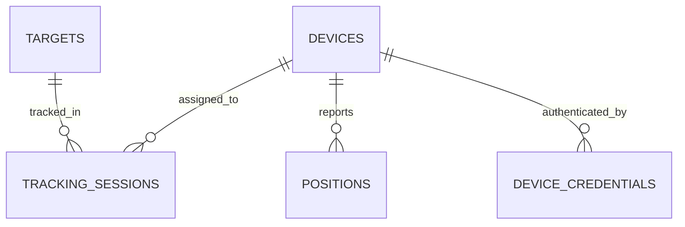
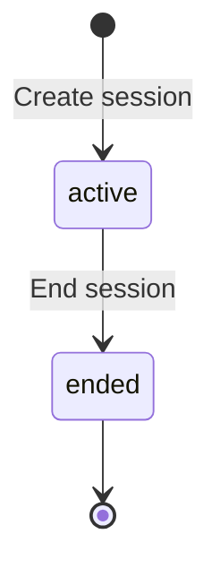
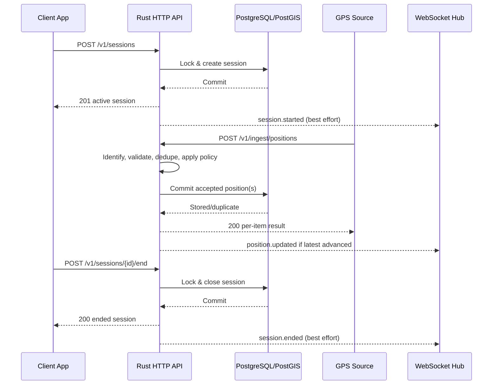
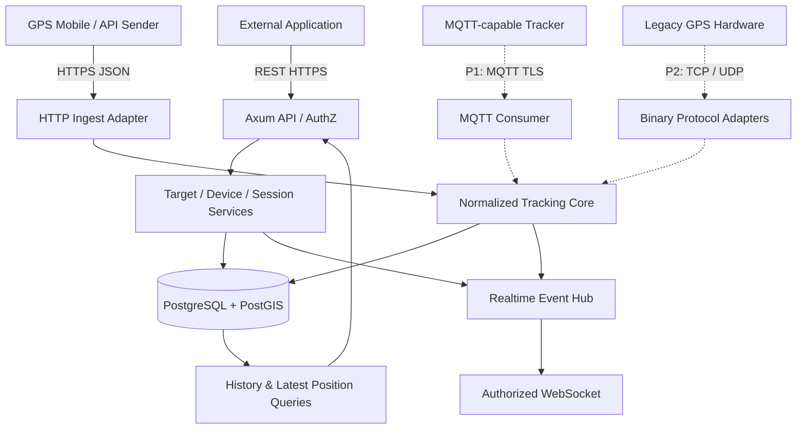
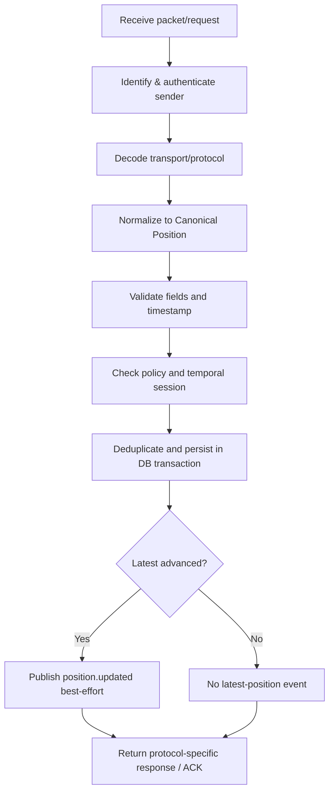
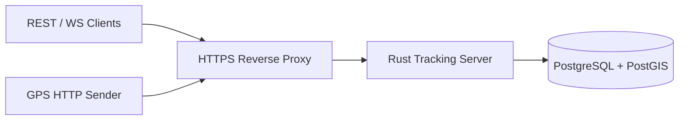

# Generic GPS Tracking Engine — Application Specification (App Spec)

> **Versi dokumen:** `1.0-final`  
> **Status:** FINAL — Perencanaan MVP v1.0 (19 Oktober 2026). Final sebagai acuan implementasi; bukan klaim implementasi selesai atau siap produksi.
> **Tanggal:** 19 Oktober 2026  
> **Platform:** Backend tracking dan portal web management  
> **Bahasa implementasi:** Rust (stable)  
> **Arsitektur awal:** Modular monolith, protocol-agnostic, session-based  
> **Dokumen terkait:** [`gps-tracking-backend-summary.md`](./gps-tracking-backend-summary.md) dan [`gps-tracking-api-contract.md`](./gps-tracking-api-contract.md)

---

## 1. Ringkasan aplikasi

**Generic GPS Tracking Engine** adalah backend mandiri untuk menerima, memvalidasi, menyimpan, menelusuri, dan mendistribusikan data posisi geografis dari berbagai sumber. Sistem bersifat **domain-neutral**: backend tidak memiliki konsep bawaan kendaraan, armada, pengemudi, kurir, atau jenis objek tertentu.

Terdapat tiga identitas yang sengaja dipisahkan:

1. **Target**: entitas abstrak yang ingin dipantau oleh sistem eksternal.
2. **Device**: sumber koordinat, misalnya aplikasi mobile, modul IoT, atau GPS tracker hardware.
3. **Tracking session**: hubungan target dan device dalam periode waktu tertentu.

**Position** adalah pengamatan lokasi yang berasal dari *device*, bukan dari *target*. Dalam kebijakan `session_only`, position hanya disimpan bila terkait periode sesi yang valid; dalam `always`, position dapat tersimpan tanpa sesi.

### 1.1 Pernyataan produk

> Satu tracking core berbasis Rust, banyak protokol input, satu representasi GPS yang dinormalisasi, dan satu API konsisten untuk posisi saat ini, riwayat, serta pembaruan real-time.

### 1.2 Sasaran utama

- **Reusable:** dapat diintegrasikan oleh lebih dari satu aplikasi tanpa perubahan domain inti.
- **Hardware-ready:** arsitektur memungkinkan dukungan perangkat GPS vendor berbeda melalui adapter terpisah.
- **Session-based:** pelacakan target dikontrol lewat waktu asosiasi, bukan dengan mengasumsikan hardware bisa di-*start* atau *stop* dari backend.
- **Reliable:** tahan duplikasi, retry, urutan paket terbalik, jaringan terputus, dan permintaan concurrent.
- **Secure:** identitas dan authorization aplikasi dipisahkan dari autentikasi device; data lokasi diperlakukan sensitif.
- **Observable:** operator dapat menilai konektivitas, tingkat penolakan data, latency, dan kesehatan layanan.

### 1.3 Bukan tujuan aplikasi

Aplikasi ini **bukan** Fleet Management System, mobile tracker client, identity provider umum untuk aplikasi lain, remote device-control platform, ataupun layanan geocoding dan route optimization.

---

Produk mencakup portal web management dalam repository yang sama. Tim mengelola target/device/session, kredensial, peta dan histori melalui API backend. Detail: [Portal Management Spec](./gps-tracking-portal-spec.md).

## 2. Cakupan dan prioritas

Prioritas: **P0 = wajib untuk MVP**, **P1 = sesudah MVP stabil**, **P2 = opsional/bergantung hardware**.

| Area | P0 — MVP | P1 | P2 |
|---|---|---|---|
| Portal | Akun/tim, registrasi device, token, target/session, peta live, histori, audit | Analitik lanjutan | Dashboard kustom |
| Domain | Organisasi/tenant, target, device, session, position | Kuota organisasi | Relasi multi-device simultan per target |
| Ingestion | HTTPS/JSON batch | MQTT consumer | GT06, Teltonika, NMEA, JT/T 808 sesuai kebutuhan |
| Query | Lokasi terakhir dan riwayat | Filter geospasial tambahan | Export dan analitik rute |
| Realtime | WebSocket best-effort | Multi-instance event fan-out | Durable replay/event streaming |
| Storage | PostgreSQL + PostGIS, retensi satu tahun dan purge worker | Partitioning | Cold storage/arsip |
| Identity | Akun/login internal management, membership, peran, izin objek, device token HTTP | Federasi external IdP | Device certificate provisioning |
| Operasional | Logging, health, metrics dasar, migration, backup plan | Alerting dan dashboard metrics | Auto-scaling lintas region |

**Tidak termasuk MVP:** modul kendaraan/driver, dispatch, geofencing lanjutan, remote engine cut-off, remote configuration perangkat, semua protokol hardware secara serentak, dan microservices.

---

## 3. Pemangku kepentingan dan aktor teknis

| Aktor/principal | Tugas | Hak akses prinsip |
|---|---|---|
| **Application client** | Mendaftarkan target/device, membuat/mengakhiri sesi, membaca data | Token aplikasi dengan scope + object-level authorization |
| **Device sender** | Mengirim lokasi ke ingestion adapter | Identitas/kredensial spesifik device, hanya boleh mengirim data atas device sendiri |
| **Realtime subscriber** | Mendapat pembaruan dari target/device yang diizinkan | Application principal dengan `tracking:subscribe` |
| **Operator sistem** | Memeriksa uptime, log, metric, backup, konfigurasi | Akses operasional privat, bukan akses lokasi tanpa batas secara default |
| **Protocol adapter** | Mengurai payload vendor dan memetakan identitas device | Boundary internal, bukan trusted otomatis karena perangkat telah mengirim identifier |

Konsep `driver`, `operator armada`, atau `asset owner` merupakan concern aplikasi eksternal dan tidak dibakukan sebagai tabel wajib di tracking core.

---

## 4. Glosarium domain dan model mental

| Istilah | Definisi | Catatan |
|---|---|---|
| `Target` | Sesuatu yang ingin dilacak | Punya `name`, `external_ref`, `metadata`, tanpa tipe bisnis wajib |
| `Device` | Sumber pesan posisi | Teridentifikasi oleh `(tenant_id, protocol, identifier)` dalam namespace terkait |
| `TrackingSession` | Penugasan satu device untuk satu target selama `[started_at, ended_at)` | `ended_at = NULL` berarti sesi aktif |
| `Position` | Koordinat yang direkam device | Mengacu ke `device_id` dan waktu rekam; tidak wajib memiliki `session_id` |
| `RecordedAt` | Waktu koordinat diambil pada sumber | Dapat tidak akurat; divalidasi terhadap jam server |
| `ReceivedAt` | Waktu koordinat diproses server | Diisi server; berguna untuk status konektivitas dan toleransi keterlambatan |
| `Protocol Adapter` | Modul penerima/decoder protokol spesifik | Menormalkan satuan, framing, dan pengakuan penerimaan paket |
| `Live Location` | Titik valid paling baru berdasarkan waktu rekam | Titik backfill lama tidak boleh memundurkan nilai ini |
| `Tracking Status` | `active|inactive` untuk target | Connectivity dan freshness posisi dipisahkan |

### 4.1 Relasi inti



Relasi position ke target **diturunkan melalui** session berdasarkan `device_id` dan interval `recorded_at`, tidak dengan menyalin target ID ke semua posisi.

---

## 5. Kebutuhan fungsional (Functional Requirements)

Identitas requirement dibuat stabil agar dapat ditelusuri ke kode, endpoint, dan pengujian.

### 5.0 Identitas dan organisasi

| ID | Prioritas | Requirement | Kriteria terpenuhi |
|---|---|---|---|
| `FR-AUTH-01` | P0 | Akun/login internal management | Provisioning, login/logout, recovery dan pencabutan sesi teruji |
| `FR-AUTH-02` | P0 | Membership dan peran organisasi | Admin/operator/viewer, grants objek, deny-by-default |
| `FR-AUTH-03` | P0 | Isolasi tenant di seluruh jalur | REST, ingestion, query, cursor dan WS menolak akses lintas organisasi |
| `FR-AUTH-04` | P0 | Pencabutan izin efektif | REST dan WS terbuka tidak mempertahankan akses yang sudah dicabut |
| `FR-RET-01` | P0 | Retensi satu tahun kalender | Filter expiry, purge bertahap, tahun kabisat dan restore teruji |

### 5.1 Target management

| ID | Prioritas | Requirement | Kriteria terpenuhi |
|---|---|---|---|
| `FR-TAR-01` | P0 | Membuat target dengan nama dan metadata opsional | Menghasilkan UUID dan timestamps server |
| `FR-TAR-02` | P0 | Membaca daftar/detail target | Terfilter oleh authorization objek, cursor pagination |
| `FR-TAR-03` | P0 | Memperbarui `name`, `external_ref`, `metadata` | Field tak dikenal ditolak, metadata berupa object JSON |
| `FR-TAR-04` | P0 | Mendapat lokasi target dari sesi aktif | Tidak mengembalikan titik sesi lama sebagai lokasi aktif |

### 5.2 Device management

| ID | Prioritas | Requirement | Kriteria terpenuhi |
|---|---|---|---|
| `FR-DEV-01` | P0 | Mendaftarkan device `name`, `protocol`, `identifier` | Identitas unik `(tenant_id, protocol, identifier)`; protokol harus dikenal |
| `FR-DEV-02` | P0 | Menetapkan `ingestion_policy` | Default `session_only`; pilihan lain `always` |
| `FR-DEV-03` | P0 | Membaca daftar/detail dan memperbarui atribut tertentu | `protocol` dan `identifier` tidak dapat diubah di MVP |
| `FR-DEV-04` | P0 | Membuat/merotasi token device HTTP | Secret ditampilkan sekali; hash disimpan; token lama dicabut atomik |
| `FR-DEV-05` | P0 | Mendapat lokasi terakhir dan riwayat device | Lokasi berdasarkan posisi tersimpan, termasuk di luar sesi untuk `always` |
| `FR-DEV-06` | P1 | Menerapkan identitas dan ACL MQTT | Principal/topic terikat ke device yang diizinkan |

### 5.3 Tracking session

| ID | Prioritas | Requirement | Kriteria terpenuhi |
|---|---|---|---|
| `FR-SES-01` | P0 | Membuat sesi target-device | Waktu mulai dari server, tidak ada start/end dari client |
| `FR-SES-02` | P0 | Mencegah lebih dari satu sesi aktif per target dan device | Konflik concurrent ditegakkan database; kembalikan `409` |
| `FR-SES-03` | P0 | Mencegah interval sesi saling overlap untuk device sama | Riwayat tidak ambigu saat query berdasarkan waktu |
| `FR-SES-04` | P0 | Menutup sesi | `ended_at` ditentukan server; pemanggilan ulang idempotent |
| `FR-SES-05` | P0 | Menampilkan sesi dan riwayat posisi berdasarkan sesi | Filter `[start, end)` terhadap `recorded_at`, bukan `received_at` |
| `FR-SES-06` | P0 | Mendukung idempotent `POST /sessions` | Header `Idempotency-Key`; key/body sama menghasilkan resource sama |
| `FR-SES-07` | P0 | Memisahkan sesi dengan aktivitas hardware | Start/end session tidak mengirim command ke device |

### 5.4 GPS ingestion

| ID | Prioritas | Requirement | Kriteria terpenuhi |
|---|---|---|---|
| `FR-ING-01` | P0 | Menerima batch GPS melalui HTTPS/JSON | 1–100 titik/request; default batas 256 KiB/request |
| `FR-ING-02` | P0 | Memvalidasi dan menormalisasi data | Koordinat finite dalam rentang; satuan SI; timestamp RFC 3339 |
| `FR-ING-03` | P0 | Menolak data device lain | Credential ingestion terikat satu `device_id` |
| `FR-ING-04` | P0 | Mendukung `session_only` dan `always` | Titik di luar sesi tidak tersimpan pada `session_only` |
| `FR-ING-05` | P0 | Deduplikasi atas retry/pengiriman ulang | Unique `(device_id, message_id)` untuk HTTP; payload bentrok ditolak |
| `FR-ING-06` | P0 | Memberi hasil per titik dalam satu batch | `stored`, `duplicate`, atau `rejected` beserta alasan |
| `FR-ING-07` | P0 | Menerima titik terlambat jika masih dalam toleransi | Histori dikaitkan berdasarkan `recorded_at`; live tidak mundur |
| `FR-ING-08` | P0 | Commit sebelum mengonfirmasi `stored` | Error storage tidak boleh menghasilkan respons sukses palsu |
| `FR-ING-09` | P1 | Konsumsi MQTT JSON versi aplikasi | Topic terikat device, validasi identik dengan HTTP |
| `FR-ING-10` | P2 | Mendecode paket tracker binary | Parser/ACK spesifik perangkat serta fixture pengujian |

### 5.5 Monitoring, history, dan realtime

| ID | Prioritas | Requirement | Kriteria terpenuhi |
|---|---|---|---|
| `FR-OBS-01` | P0 | Menyediakan latest location device/target | Perhitungan fresh berdasar waktu yang benar dan data tidak out-of-order |
| `FR-OBS-02` | P0 | Menyediakan histori position secara cursor-based | Sorting `recorded_at DESC, id DESC`, filter `from`/`to` |
| `FR-OBS-03` | P0 | Menyajikan status terpisah | Tracking `active/inactive`, connectivity `online/offline/unknown`, posisi `fresh/stale/no_position` |
| `FR-HB-01` | P0 | Heartbeat HTTP tanpa koordinat | Token device, kontak server monotonik, tidak memerlukan/mengubah tracking session |
| `FR-HB-02` | P0 | Timeout konektivitas dan event | Heartbeat/backfill tidak memperbarui freshness posisi; timeout dan restart teruji |
| `FR-OBS-04` | P0 | WebSocket untuk subscribe target/device | Unauthorized ID ditolak tanpa mengubah subscription berjalan |
| `FR-OBS-05` | P0 | Menyiarkan `position.updated`, `session.started`, `session.ended`, `tracking.status_changed` | Event tidak mendahului commit dan tidak diterbitkan karena duplikasi |
| `FR-OBS-06` | P0 | Mendukung reconnect tanpa replay wajib | Klien fetch ulang snapshot via REST setelah subscribe |

### 5.6 Operasional dan platform

| ID | Prioritas | Requirement | Kriteria terpenuhi |
|---|---|---|---|
| `FR-OPS-01` | P0 | Health endpoint | `/healthz` dan `/readyz` tersedia sesuai kontrak |
| `FR-OPS-02` | P0 | Structured logs, request ID, audit kritis | Token dan koordinat sensitif tidak dicatat sembarangan |
| `FR-OPS-03` | P0 | Database migration dan konfigurasi environment | Deployment baru dapat diinisialisasi secara terulang |
| `FR-OPS-04` | P0 | Backup/restore dan retensi terdefinisi sebelum produksi | Restore drill dan kebijakan penghapusan disetujui |
| `FR-OPS-05` | P1 | Load test, alarm, dan monitoring terotomasi | Angka kapasitas didasarkan hasil pengukuran |

---

## 6. Aturan bisnis dan invariant domain

| ID | Invariant | Implementasi yang diharapkan |
|---|---|---|
| `BR-01` | `Target` bukan `Device` | Data model terpisah dan tidak ada field kendaraan/driver wajib |
| `BR-02` | Maksimum satu sesi aktif untuk target | Partial unique index atau constraint ekuivalen |
| `BR-03` | Maksimum satu sesi aktif untuk device | Partial unique index atau constraint ekuivalen |
| `BR-04` | Rentang historis untuk device sama tidak overlap | DB exclusion constraint untuk interval atau strategi transaksi+locking teruji |
| `BR-05` | Session dibuat/diakhiri dengan server clock | Server menetapkan `started_at`, `ended_at`; tidak backdate pada MVP |
| `BR-06` | Periode sesi adalah `[started_at, ended_at)` | Start inklusif, end eksklusif; end `NULL` berarti terbuka |
| `BR-07` | Posisi tersimpan selalu memiliki `device_id` | Tidak perlu foreign key wajib ke session |
| `BR-08` | `received_at` diisi server | Tidak berasal dari request GPS atau firmware |
| `BR-09` | Pengulangan `message_id` identik tidak menambah position | Unique key + immutable payload fingerprint / pembandingan data |
| `BR-10` | `message_id` sama dengan isi berbeda adalah konflik | Ditolak dan dicatat audit |
| `BR-11` | Data terlambat tidak memundurkan latest position | Perbandingan `(recorded_at, id)` dan update monotonik |
| `BR-12` | Status session tidak sama dengan status tracking | Offline tidak menutup session secara otomatis |
| `BR-13` | Error antar item batch terisolasi | Mixed result dibolehkan pada HTTP `200` setelah pemrosesan |
| `BR-14` | No unauthorized visibility | Semua query dan subscriptions menerapkan per-object authorization |
| `BR-15` | ACK protokol memiliki makna spesifik | MQTT PUBACK atau ACK packet bukan otomatis bukti insert DB |

### 6.1 State machine session



- `status` diproyeksikan dari `ended_at`, bukan state yang bebas diubah klien.
- `ended` bersifat terminal pada MVP; tidak ada `resume` atau `reopen`.
- Periode tracking baru memerlukan session baru.

### 6.2 State tracking, konektivitas dan posisi

- Target: `inactive` tanpa sesi aktif, `active` jika ada sesi aktif.
- Device: `unknown` sebelum pernah ada kontak, `online` saat kontak terakhir masih dalam timeout, `offline` setelah timeout. Tidak otomatis menutup session.
- Posisi: `no_position` bila tidak tersedia, `fresh`/`stale` berdasarkan usia `recorded_at`. Heartbeat tidak memperbarui posisi.
- Target tanpa sesi aktif tidak menampilkan konektivitas device sesi lama. Target dengan sesi aktif dapat menampilkan device online sekalipun belum ada posisi.

Definisi field, event dan boundary timeout pada API Contract §7.4 menggantikan state gabungan online/offline sebelumnya.

### 6.3 Ketentuan waktu dan edge case

1. Gunakan UTC untuk penyimpanan; klien mengirim RFC 3339 dengan offset yang kemudian dinormalisasi.
2. **Batas jendela sesi** memakai `recorded_at` dan interval `[started_at, ended_at)`.
3. Default **baseline MVP**: `max_future_skew = 2m`, `max_late_arrival = 24h`, `position_freshness_timeout = 60s`.
4. Setelah session berakhir, titik dengan `recorded_at` yang berada di dalam sesi masih dapat disimpan selama jendela late-arrival, sesuai kebijakan device.
5. Posisi backfill yang lebih lama tidak menghasilkan `position.updated` jika tidak memajukan latest location.
6. Dua request membuat sesi untuk device sama yang berlangsung bersamaan harus menghasilkan satu sukses dan satu `409`.
7. Dua request mengakhiri sesi yang sama harus mengembalikan waktu akhir yang sama.
8. Untuk `session_only`, timestamp `received_at < recorded_at <= received_at + 2m` belum disimpan: hasil `rejected`, `reason = TIMESTAMP_NOT_READY`, `retryable = true`, `retry_after_ms` sebesar selisih waktu dibulatkan ke atas. Sender mengirim ulang payload dan `message_id` yang sama setelah waktu tersebut; penerimaan berikutnya tetap memeriksa interval sesi final. Jika sesi sudah berakhir sebelum `recorded_at`, hasilnya `OUTSIDE_SESSION`. Timestamp lebih dari 2 menit di depan ditolak dengan `TIMESTAMP_IN_FUTURE`. Untuk `always`, timestamp dalam toleransi dapat langsung disimpan. Tidak ada timestamp yang dikoreksi diam-diam.
9. Setelah autentikasi dan validasi struktur, periksa pesan yang sudah tersimpan sebelum mengevaluasi ulang batas waktu/policy. Payload identik menghasilkan `duplicate`, payload berbeda `MESSAGE_ID_CONFLICT`; retry tidak memperbarui `received_at` atau retensi baris lama.

---

## 7. User journey dan sequence flows

### 7.1 Registrasi dan provisioning

1. Application client memakai token yang dapat mengelola target/device.
2. Membuat target via `POST /v1/targets`.
3. Membuat device via `POST /v1/devices` dengan protokol yang diaktifkan.
4. Untuk `http-json`, memanggil `POST /v1/devices/{id}/credentials/rotate` agar mendapatkan ingestion token satu kali.
5. Device sender menggunakan token itu untuk ingestion ke `POST /v1/ingest/positions`.
6. Untuk hardware legacy, credential/provisioning mengikuti kemampuan protokol dan tidak disamakan dengan rotasi token HTTP.

### 7.2 Start session, streaming, end session



### 7.3 Reconnect dan offline buffer

- Pengirim GPS mempertahankan `message_id` yang sama saat retry agar idempotent.
- Jika pengirim menyimpan titik di lokal, kirim batch dengan `recorded_at` asal ketika koneksi pulih.
- Backend menilai setiap point menggunakan policy, tidak mengganti `recorded_at` dengan waktu upload.
- Jika WebSocket putus, subscriber melakukan reconnect, subscribe ulang, lalu memuat snapshot dari REST; tidak mengasumsikan semua event terdahulu diterima.

---

## 8. Arsitektur sistem

### 8.1 Prinsip

- **Modular monolith:** satu executable server Rust; domain, protocol, storage, realtime dipisahkan dalam modul/workspace crates.
- **Ports and adapters:** input HTTP/MQTT/TCP merupakan adapter; tracking core menerima event yang sudah dinormalisasi.
- **Database is source of truth:** WebSocket adalah jalur notifikasi best-effort.
- **Security at boundary and domain layer:** authorization HTTP saja tidak cukup; service/repository tetap wajib memeriksa scope objek.
- **No premature distributed infrastructure:** Redis/Kafka/service split baru dipilih setelah ada kebutuhan terukur.

### 8.2 Diagram komponen



Garis putus-putus menandakan fitur fase berikutnya, **bukan fitur yang sudah tersedia pada MVP**.

### 8.3 Modul dan tanggung jawab

| Modul/crate | Responsibility | Tidak boleh melakukan |
|---|---|---|
| `tracking-core` | Domain types, validation, session policy, normalized position | Parsing protokol vendor dan HTTP concerns |
| `tracking-protocols` | Decode/framing/protocol-specific ACK | Menentukan domain target dan session |
| `tracking-storage` | SQLx queries, transaction, geospatial schema | Mengembalikan HTTP response secara langsung |
| `tracking-realtime` | Fan-out event dan subscription handling | Menjadi satu-satunya penyimpan event/posisi |
| `server` | Config, composition root, Axum routes, transport listeners | Menyatukan semua business rules dalam handler |

### 8.4 Struktur repository yang ditetapkan

```text
gps-tracking/
├── Cargo.toml                 # Cargo workspace
├── Cargo.lock
├── crates/
│   ├── tracking-core/
│   ├── tracking-protocols/
│   ├── tracking-storage/
│   └── tracking-realtime/
├── apps/
│   ├── server/
│   │   └── src/
│   └── portal/                # React/Vite/TypeScript
├── contracts/                # OpenAPI dan schema WebSocket
├── migrations/
├── tests/
│   ├── integration/
│   ├── concurrency/
│   ├── contracts/
│   └── protocol-fixtures/
├── deploy/
└── docs/
    ├── gps-tracking-backend-summary.md
    ├── gps-tracking-api-contract.md
    └── gps-tracking-app-spec.md
```

### 8.5 Stack awal

Portal menggunakan React + Vite, Tailwind CSS dan shadcn/ui sesuai keputusan pengguna. TypeScript dan library inti ditetapkan melalui delegasi pengguna di [Frontend Stack](./gps-tracking-frontend-stack.md); Zustand tetap kondisional, dependency belum dipasang.

| Layer | Pilihan |
|---|---|
| Language | Rust stable |
| Web API / WS | Axum |
| Async runtime | Tokio |
| Database | PostgreSQL |
| Geospatial | PostGIS |
| Database access / migrations | SQLx |
| Serialization | Serde / serde_json |
| Time / ID | chrono / uuid |
| Structured tracing | tracing |
| Binary frame decoding | tokio-util codec, jika sesuai varian protokol |
| MQTT (P1) | rumqttc + broker terpisah jika dibutuhkan |

Versi dependency disematkan di `Cargo.lock` pada saat implementasi dan diperbarui melalui proses upgrade teruji; dokumen ini tidak mensyaratkan versi crate tertentu.

---

## 9. Data specification

### 9.0 Isolasi organisasi wajib MVP

- `organizations`, `users`, `memberships`, sesi autentikasi, dan grant akses objek menjadi entitas tambahan P0. Sesi autentikasi berbeda dari `tracking_sessions`.
- `targets`, `devices`, `tracking_sessions`, `positions`, kredensial, idempotency records, dan audit memuat `tenant_id`. UUID device tetap unik global; identifier bisnis unik dalam tenant/protokol.
- Gunakan FK komposit yang menjamin posisi-device dan session-target-device memiliki tenant yang sama. Semua query, cursor, deduplikasi, dan subscription dibatasi tenant terverifikasi.
- Klien tidak dapat menetapkan kepemilikan hanya dengan mengirim `tenant_id`. Pemilihan organisasi harus memverifikasi membership aktif. Transfer device/target antarorganisasi tidak didukung MVP.
- Organisasi dibuat pengelola platform yang menyiapkan admin pertama; admin organisasi mengundang anggota. Tidak ada registrasi publik. Satu akun dapat memiliki beberapa membership dengan satu konteks organisasi aktif; role platform tidak otomatis memberi akses lokasi organisasi. Detail alur mengikuti Portal Spec §3.1.
- Peran awal: admin mengelola organisasi dan seluruh objeknya; operator mengelola objek yang diberikan; viewer hanya membaca objek yang diberikan. Hanya admin yang mengelola membership, grant, dan perubahan `ingestion_policy` ke `always`. Operator memerlukan izin khusus `devices:credentials:write` pada device terkait untuk menerbitkan/merotasi token; izin write biasa tidak cukup.
- Akses target/session tidak otomatis memberikan akses ke seluruh histori device. Endpoint histori device memerlukan grant device secara eksplisit; event target tidak membocorkan periode atau target lain.


### 9.1 Logical entities

| Tabel | Field utama | Constraint dan indeks penting |
|---|---|---|
| `targets` | `id`, `name`, `external_ref`, `metadata`, `created_at`, `updated_at` | `id` UUID PK; `external_ref` non-null unik per tenant |
| `devices` | `id`, `name`, `protocol`, `identifier`, `ingestion_policy`, `metadata`, timestamps | Unique `(tenant_id, protocol, identifier)`; policy enum/check |
| `tracking_sessions` | `id`, `target_id`, `device_id`, `started_at`, `ended_at`, `created_at` | FK valid; one active session per target/device; anti-overlap |
| `positions` | `id`, `device_id`, `message_id`, `location`, `altitude_m`, `speed_mps`, `heading_deg`, `accuracy_m`, `recorded_at`, `received_at`, `attributes`, `payload_fingerprint` (internal) | `BIGINT` PK; `(device_id, message_id)` unique jika ID ada; `(device_id, recorded_at DESC, id DESC)` |
| `device_credentials` | `id`, `device_id`, `token_hash`, `created_at`, `revoked_at` | Token raw tidak disimpan; rotasi atomik |
| `idempotency_records` | `principal_id`, `route_key`, `idempotency_key`, `request_hash`, `response`, `expires_at` | Unique per principal + endpoint + key |
| `audit_logs` | `id`, `actor_ref`, `action`, `resource_ref`, `result`, `occurred_at` | Kebijakan akses dan retensi terpisah |

Kolom internal tambahan (`payload_fingerprint`, credential storage, idempotency, audit) adalah detail implementasi yang tidak harus terekspos di API.

### 9.2 Koordinat dan waktu

- Simpan koordinat geospasial pada `GEOGRAPHY(Point, 4326)`.
- Ketika membangun point PostGIS, urutan input `ST_MakePoint` adalah `(longitude, latitude)`.
- Koordinat dipaparkan ke API sebagai field `latitude` dan `longitude` terpisah.
- `positions.id` dapat menggunakan `BIGINT`, tetapi dikirim sebagai **string desimal** melalui JSON.
- Urutan histori: `recorded_at DESC, id DESC`, agar stabil ketika timestamp sama.
- Query riwayat sesi adalah join temporal dari posisi device dan `[started_at, ended_at)`.
- Pertimbangkan partitioning berdasarkan waktu hanya setelah pola pertumbuhan dan query terukur.

### 9.3 Transaksi dan batas atomisitas

- Pembuatan/penutupan session dan ingestion yang memerlukan pemeriksaan rentang waktu harus memakai strategi locking konsisten.
- Deduplikasi harus aman terhadap concurrent writers melalui unique index, bukan hanya precheck di kode.
- Successful HTTP `stored` berarti row sudah commit.
- Latest position dapat diperoleh melalui query terindeks atau tabel materialized/latest cache dengan conditional monotonic update; jika cache dipakai, tentukan prosedur rebuild.
- WebSocket tidak merupakan bagian dari DB transaction; kegagalan broadcast tidak membatalkan commit posisi.
- Untuk event yang **wajib** tidak hilang pada masa depan, gunakan transactional outbox; MVP tetap best-effort.

### 9.4 Retensi dan deletion

- Retensi posisi default **365 hari (satu tahun kalender) sejak `recorded_at`**, UTC; `POSITION_RETENTION_DAYS` dapat mengubah kebijakan menjadi 1–36.500 hari. Default 365 mempertahankan 29 Februari menjadi 28 Februari pada tahun berikutnya. Server dan retention worker harus menggunakan nilai yang sama; worker juga membersihkan row lama yang melewati cutoff setelah nilai diturunkan.
- Semua query lokasi/histori dan snapshot mengecualikan posisi kedaluwarsa. Worker P0 menghapusnya secara bertahap, berjalan minimal setiap jam; kegagalan worker menghasilkan alert dan tidak membuka akses data kedaluwarsa.
- Retensi tidak diperpanjang oleh retry atau `received_at`. Backup recovery window 30 hari (dependency maksimal 37 hari) dan audit 365 hari mengikuti Database & Operations; restore harus menjalankan purge sebelum API dibuka kembali.
- Pilihan `session_only` merupakan default privasi, bukan pengganti kebijakan retensi dan consent yang berlaku.
- Strategi archival/purge, backup retention, dan penghapusan berdasarkan permintaan perlu didokumentasikan sesuai aturan organisasi pengguna.
- Penghapusan target/device pada MVP belum disediakan melalui public API untuk menghindari implikasi referensial yang belum dirancang.

---

## 10. Normalized ingestion pipeline

### 10.1 Tahapan wajib



Diagram ini menunjukkan dependensi logis; urutan ACK dan batching final mengikuti kebutuhan protokol. Tidak boleh mengirim sukses `stored` sebelum commit aman. Setiap adapter harus membuat alasan penolakan yang dapat diobservasi tanpa membocorkan secret.

### 10.2 Canonical message

```json
{
  "device_id": "550e8400-e29b-41d4-a716-446655440002",
  "protocol": "http-json",
  "message_id": "a4b8e7f1",
  "position": {
    "latitude": -6.8048,
    "longitude": 110.8419,
    "altitude_m": 28.5,
    "speed_mps": 9.5,
    "heading_deg": 135.0,
    "accuracy_m": 8.5,
    "recorded_at": "2026-10-19T03:00:10Z"
  },
  "attributes": {
    "battery_percent": 86,
    "satellites": 12
  }
}
```

Model ini adalah **internal normalized representation**, bukan bukti kompatibilitas dengan semua tracker. `device_id` internal baru sah setelah identifikasi, verifikasi, dan mapping terhadap record device berhasil.

### 10.3 HTTP batch behavior

- Header `Authorization: Bearer <device_ingest_token>`.
- Request mengandung `device_id` dan `points`; token harus mengizinkan device yang sama.
- `message_id` diwajibkan pada HTTP/MQTT; pada legacy hardware dapat tidak tersedia.
- Jika request secara keseluruhan tidak sah, kembalikan HTTP error standar tanpa partial side effect yang ambigu.
- Setiap item terstruktur valid diproses secara independen dan mengembalikan `stored|duplicate|rejected`.
- `200 OK` dapat berisi hasil campuran; respons transient `5xx` boleh diretry menggunakan ID pesan semula.
- Jika `message_id` sama dengan payload berbeda, kembalikan `MESSAGE_ID_CONFLICT` dan audit.

### 10.4 Strategi hardware

**MVP:** belum mengeklaim kompatibilitas native terhadap perangkat binary apa pun. Membangun boundary plugin/adapters sejak awal.

**Rencana urutan:**

1. `http-json` (P0), simulasi client dan uji integrasi.
2. `mqtt-json` (P1), topic `tracking/v1/devices/{device_id}/positions`; payload JSON **konvensi aplikasi**, bukan standar payload universal.
3. Satu protokol tracker nyata (P2), dipilih dari hardware yang benar-benar tersedia untuk diuji.
4. Adapter lanjutan (GT06 family, Teltonika Codec 8/8E, dll.) ditambahkan berbasis model/firmware yang terdokumentasi.

**Adapter binary wajib menangani:** packet boundaries/CRC bila ada, login/handshake, identifikasi device, koordinat/satuan, timestamp, kemungkinan pesan multi-record, keepalive, disconnect/reconnect, batas ukuran frame, serta ACK spesifik protokol.

**Batas kepercayaan:** IMEI/identifier **bukan** secret autentikasi. Perangkat TCP legacy tanpa TLS memerlukan kompensasi jaringan, hardening listener, dan dokumentasi residual risk.

### 10.5 MQTT semantics (P1)

- Gunakan broker MQTT dengan autentikasi/ACL publish per device.
- Topic versioned: `tracking/v1/devices/{device_id}/positions`.
- QoS 1 bila sesuai untuk at-least-once; deduplikasi di engine tetap diperlukan.
- MQTT `PUBACK` menegaskan hop ke broker, **tidak otomatis** menegaskan commit PostgreSQL.
- Hindari retained position sebagai default agar message lama tidak disalahartikan sebagai pengamatan baru.

---

## 11. Kontrak antarmuka publik

**API Contract adalah sumber kebenaran untuk detail HTTP path, status code, field JSON, dan WebSocket payload.** App Spec ini mendefinisikan perilaku dan batasan produk, bukan menggantikan kontrak tersebut.

| Capability | Endpoint / interface | Requirement |
|---|---|---|
| Target CRUD terbatas | `/v1/targets`, `/v1/targets/{id}` | `FR-TAR-01..03` |
| Lokasi target | `GET /v1/targets/{id}/location` | `FR-TAR-04` |
| Registrasi dan query device | `/v1/devices`, `/v1/devices/{id}` | `FR-DEV-01..03` |
| Rotasi ingestion token | `POST /v1/devices/{id}/credentials/rotate` | `FR-DEV-04` |
| Posisi/lokasi device | `GET /v1/devices/{id}/location`, `/positions` | `FR-DEV-05` |
| Session lifecycle | `POST /v1/sessions`, `GET /v1/sessions`, `POST /v1/sessions/{id}/end` | `FR-SES-01..07` |
| History session | `GET /v1/sessions/{id}/positions` | `FR-SES-05` |
| Heartbeat device | `POST /v1/ingest/heartbeat` | `FR-HB-01..02` |
| HTTP ingestion | `POST /v1/ingest/positions` | `FR-ING-01..08` |
| WS ticket untuk browser | `POST /v1/realtime/tickets` | `FR-OBS-04` |
| Stream events | `GET /v1/ws/tracking` | `FR-OBS-04..06` |
| Health | `/healthz`, `/readyz` | `FR-OPS-01` |
| MQTT (P1) | `tracking/v1/devices/{device_id}/positions` | `FR-ING-09` |

### 11.1 Error handling

- Respons error JSON mengikuti bentuk `{ "error": { "code", "message", "details", "request_id" } }`.
- Pilihan status: `400`, `401`, `403`, `404`, `409`, `413`, `422`, `429`, `500`, `503`; successful operations sesuai kontrak.
- Session conflict = `409 SESSION_CONFLICT`; idempotency key konflik = `409 IDEMPOTENCY_CONFLICT`.
- Jangan mengungkap secret, stack trace internal, atau data milik objek lain dalam respons.

### 11.2 API versioning

- Path prefiks `/v1`.
- Perubahan breaking schema/semantik menggunakan versi baru dan migration notice.
- Setiap endpoint publik tercakup automated contract tests dan OpenAPI 3.1 setelah finalisasi skema.

---

## 12. Realtime behavior

### 12.1 Autentikasi dan subscription

- Native clients dapat menggunakan bearer token pada handshake jika didukung client.
- Browser menggunakan **ephemeral single-use ticket** dari `POST /v1/realtime/tickets`, maksimum 60 detik masa berlaku.
- Jangan meletakkan primary access token pada URL WebSocket.
- Validasi `Origin` untuk browser; ticket perlu dilindungi dari access logs.
- Klien mengirim `subscribe` dengan `target_ids` dan/atau `device_ids`, maksimal 100 ID gabungan per koneksi (default rancangan).
- Subscriptions menggantikan set sebelumnya; bila ada ID tidak sah, set sebelumnya tidak berubah.

### 12.2 Event minimum

| Event | Trigger | Delivery |
|---|---|---|
| `session.started` | Session berhasil dibuat dan commit | Best-effort |
| `session.ended` | Session berakhir dan commit | Best-effort |
| `position.updated` | Position baru yang memajukan latest location | Best-effort, bukan replay stream |
| `tracking.status_changed` | Sesi aktif target berubah | Best-effort |
| `device.connectivity_changed` | Kontak/timeout mengubah konektivitas | Best-effort |
| `position.status_changed` | Usia/ketersediaan posisi berubah | Best-effort |

Event target tidak boleh menampilkan posisi tanpa session aktif yang sesuai saat event diterbitkan, meskipun subscriber device dapat menerima event device sesuai izin dan kebijakan. Event dapat hilang ketika client offline; pola recovery adalah **resubscribe + REST snapshot**.

---

## 13. Security, privasi, dan trust boundary

### 13.1 Authentication dan authorization

- **Application principal:** akun internal portal menggunakan opaque cookie sesi; tenant eksplisit per request diverifikasi membership. Token integrasi non-browser terikat owner dan satu tenant dengan scopes/grants terbatas. Rincian pada Management API.
- **Device principal:** token ingestion HTTP yang terikat satu device, tanpa izin administrasi.
- **Browser WS ticket:** short-lived, single-use, authorized untuk berlangganan, bukan token utama.
- **Hardware adapter:** sesuai protokol spesifik; jangan menganggap identifier adalah bukti otentik.
- Selalu periksa principal, scope, object ownership/namespace, serta batas akses data di service layer.

### 13.1.1 Kebutuhan akun dan login internal (P0)

- **Keputusan keamanan login:** email/password, undangan dan reset password lewat tautan email sekali pakai; MFA wajib untuk pengelola platform, admin organisasi, dan operator dengan izin kredensial device; opsional bagi pengguna lain.
- Recovery MFA menggunakan recovery codes sekali pakai; reset password tidak menghapus MFA. Pengguna dapat melihat dan mencabut sesi perangkat lain. Kewajiban MFA mempertimbangkan semua membership akun. Detail dan acceptance mengikuti Portal Spec §3.2; metode faktor kedua TOTP; cookie sesi HttpOnly + CSRF, idle 30 menit/absolute 12 jam, kontrak pada Management API.

- Akun management menggunakan email dan password; password disimpan dengan password hashing adaptif, tidak sebagai plaintext atau hash cepat. Pengelola platform menyiapkan organisasi/admin awal, kemudian admin mengundang anggota; registrasi publik tidak tersedia pada MVP. Bootstrap pengelola pertama harus melalui jalur terkontrol.
- Login, logout, pencabutan sesi, pembaruan token, perubahan password, dan recovery akun harus memiliki kontrak sebelum implementasi auth. Token tidak boleh diterima hanya karena memuat tenant/role yang dikirim client.
- Login/recovery dibatasi laju dan memakai respons yang tidak mengungkap keberadaan akun. Perubahan password/recovery mencabut sesi lama; token diperbarui saat perubahan privilege.
- Pencabutan membership, grant, atau sesi autentikasi berlaku pada REST dan koneksi WebSocket yang sudah terbuka. Audit akses lokasi tidak menyimpan koordinat/token mentah.
- Acceptance: kredensial salah, logout/replay token, pencabutan akses saat WS aktif, lintas tenant, serta viewer mencoba write wajib ditolak. Jalur bootstrap/recovery juga diuji.
- Rujukan keamanan: [OWASP Authentication](https://cheatsheetseries.owasp.org/cheatsheets/Authentication_Cheat_Sheet.html) dan [Session Management](https://cheatsheetseries.owasp.org/cheatsheets/Session_Management_Cheat_Sheet.html).

### 13.2 Proteksi data

- Gunakan HTTPS/WSS untuk antarmuka publik; MQTT TLS jika perangkat mendukung.
- Password/token disimpan hashed atau dikelola sebagai secret sesuai jenis credential.
- Jangan logging payload posisi mentah, query string ticket, access token, atau IMEI tanpa pembatasan akses dan redaksi yang disadari.
- Data lokasi adalah sensitif: tentukan purpose, retention, deletion, access audit, dan kebijakan keterbukaan/consent sebelum produksi.
- Terapkan request size limit, timeout, koneksi maksimum, dan rate limits terhadap endpoint/listener yang terpapar jaringan.
- Proteksi DB melalui least-privilege role; gunakan migration user terpisah jika deployment mendukung.

### 13.3 Threat dan mitigasi awal

| Ancaman | Mitigasi awal | Residual risk |
|---|---|---|
| Token device bocor | Hash at rest, rotasi, pembatasan satu device, rate limit | Request palsu sebelum token dicabut |
| Spoofing IMEI legacy | Allowlisting/network segmentation, parser validation, pemantauan anomali | Tidak ada auth kriptografis bawaan protokol tertentu |
| Akses lintas target/device | Object-level auth pada REST dan WS; negative tests | Bug authorization tetap perlu diuji berkala |
| Replay/duplikasi GPS | `message_id`, unique DB, payload fingerprint, late window | Hardware tanpa stable ID masih best-effort |
| Packet parser bug | Framing bounds, fuzz/property tests, timeouts | Variasi firmware bisa tidak terdokumentasi |
| Kebocoran lokasi lewat log | Structured redacted logging dan audit akses | Teks exception/vendor payload perlu disaring |
| Penyalahgunaan resource | Connection caps, body limits, queues bounded, backpressure | DDoS perlu mitigasi di edge/network |

---

## 14. Non-functional requirements (NFR)

Angka di bawah adalah **target desain awal yang harus diverifikasi lewat pengujian**, bukan benchmark nyata atau SLO produksi yang sudah terjamin.

| ID | Area | Target/usulan verifikasi |
|---|---|---|
| `NFR-01` | Correctness | Tidak ada duplicate row untuk `(device_id, message_id)` di bawah concurrent retries |
| `NFR-02` | Consistency | Session conflict dan temporal association lulus race/concurrency tests |
| `NFR-03` | Durability | HTTP `stored` hanya sesudah commit; DB unavailable menghasilkan retryable error |
| `NFR-04` | Availability | Health/readiness bisa membedakan proses hidup dan dependency siap |
| `NFR-05` | Performance | Kandidat target uji: p95 ingestion batch <= 300 ms di lingkungan staging terdefinisi, tidak termasuk latency internet; dikalibrasi setelah benchmark |
| `NFR-06` | Capacity | Minimal uji simulasi 100 device @ 1 titik/10s dan burst 10x; **bukan** janji kapasitas final |
| `NFR-07` | Input safety | Default body HTTP <= 256 KiB, <= 100 points; attributes <= 4 KiB/item |
| `NFR-08` | WS resource safety | <= 100 ID subscriptions/koneksi (default), bounded outbound buffers, slow clients disconnected/controlled |
| `NFR-09` | Observability | Request ID, metrics berhasil/ditolak/duplikat, latency, WS count, DB pool, error rate |
| `NFR-10` | Recoverability | Backup/restore exercise sebelum produksi; target RPO <=5 menit/RTO <=4 jam, wajib diverifikasi |
| `NFR-11` | Privacy | Aturan retensi, akses, dan penghapusan ditandatangani sebelum produksi |
| `NFR-12` | Portability | Development via Docker Compose atau local services; produksi dapat berjalan sebagai satu service Rust |

**Kapasitas kasar untuk sizing:** 100 perangkat × 1 posisi/10 detik = 10 posisi/detik saat steady state, belum termasuk burst/retry/metadata. Perhitungan ini hanya membantu memilih skenario pengujian.

### 14.0 Skala penggunaan awal — disepakati

- Penggunaan awal oleh pemilik proyek: **2 organisasi dan sekitar 100 device total**. Angka 100 ditafsirkan sebagai total lintas organisasi, bukan per organisasi; pembagiannya belum ditentukan dan tidak harus merata.
- Pengiriman posisi **adaptif berdasarkan pergerakan**, ditentukan client; tidak ada interval tetap yang diwajibkan backend. Skenario 10 detik pada NFR hanyalah baseline pengujian sintetis. Algoritma movement berada di luar lingkup backend.
- Retensi tetap satu tahun kalender. Estimasi berikut memakai 365 hari, semua 100 device mengirim dan memiliki sesi sah 24 jam/hari, tanpa duplikasi/rejection; jumlah riil mengikuti waktu sesi dan aktivitas device.

| Interval per device | Posisi/detik rata-rata | Posisi/hari | Posisi/365 hari |
|---|---:|---:|---:|
| 10 detik | 10 | 864.000 | 315.360.000 |
| 30 detik | 3,33 | 288.000 | 105.120.000 |
| 60 detik | 1,67 | 144.000 | 52.560.000 |

Angka ini bukan ukuran disk atau jaminan kapasitas. Sizing storage wajib mengukur row, JSON attributes, index, WAL dan backup; load test juga mencakup burst pengiriman ulang/backfill. Infrastruktur dan partitioning dipilih berdasarkan pengukuran rata-rata posisi per device per hari, peak request/points per detik, serta burst backfill. Uji mencakup device diam lama, bergerak aktif, dan batch setelah offline. Backend mempertahankan recorded_at sumber, batas batch, deduplikasi dan session policy tanpa mengasumsikan cadence tetap.

### 14.0.1 Heartbeat pada pengiriman adaptif — P0 disepakati

Heartbeat terautentikasi tanpa koordinat masuk MVP. Tidak ada posisi baru bukan bukti device terputus. Pisahkan tracking session, konektivitas dan usia posisi. Heartbeat dapat masuk tanpa sesi, hanya memperbarui kontak terakhir, tidak menciptakan histori lokasi atau mengubah retensinya.

Detail endpoint/status mengikuti API Contract §7.4. Simpan hanya timestamp kontak terbaru per device; tidak memerlukan histori heartbeat satu tahun. Default MVP disepakati: heartbeat setiap 60 detik jika tidak ada komunikasi ingestion yang berhasil, offline saat umur kontak mencapai 180 detik. Nilai tetap konfigurabel dan wajib diuji pada batas timeout. Freshness posisi 60 detik adalah label usia sampel, bukan kewajiban cadence. Traffic load test mencakup heartbeat 100 device dan burst reconnect.

### 14.1 Metrics minimal

- `ingest_points_total{protocol,result}` dan `ingest_requests_total{status}`.
- `ingest_latency_seconds` (histogram), `storage_commit_latency_seconds`.
- `session_conflict_total`, `duplicate_message_total`, `invalid_position_total`.
- `websocket_connections_active`, `websocket_events_dropped_total`.
- `device_freshness_seconds` (agregasi aman, hati-hati cardinality per device).
- DB pool usage, query latency, readiness failures, CPU/memory.

Dilarang memasukkan koordinat mentah atau token sebagai label metrics karena risiko privasi dan cardinality.

---

## 15. Konfigurasi aplikasi

Nama variabel di bawah ditetapkan sebagai baseline konfigurasi; perubahan dicatat dalam revisi dokumen. Nilai default tetap memerlukan pengujian pada lingkungan deployment.

| Env key | Tujuan | Nilai/desain awal |
|---|---|---|
| `SERVER_BIND` | Bind HTTP | `0.0.0.0:8080` untuk container, hanya expose via proxy TLS |
| `DATABASE_URL` | DSN PostgreSQL | Secret, dari secret manager/.env lokal |
| `DATABASE_POOL_MAX` | Batas koneksi DB | `20` default aplikasi; tuning hanya setelah pengukuran |
| `MAX_INGEST_POINTS` | Points per request | `100` |
| `MAX_INGEST_BODY_BYTES` | Body size | `262144` |
| `MAX_ATTRIBUTES_BYTES` | Attributes JSON/item | `4096` |
| `MAX_FUTURE_SKEW_SECONDS` | Toleransi clock maju | `120` |
| `MAX_LATE_ARRIVAL_SECONDS` | Jendela keterlambatan | `86400` |
| `POSITION_FRESHNESS_SECONDS` | Ambang usia sampel posisi | `60`, nilai awal teknis |
| `HEARTBEAT_INTERVAL_SECONDS` | Cadence heartbeat yang dianjurkan | `60`, default disepakati |
| `DEVICE_OFFLINE_TIMEOUT_SECONDS` | Ambang umur kontak device | `180`, default disepakati |
| `WS_MAX_SUBSCRIPTIONS` | Batas subscription/koneksi | `100` |
| `WS_TICKET_TTL_SECONDS` | Masa berlaku tiket WS | `60` (maksimum) |
| `RUST_LOG` | Level log | `info`, terfilter per module |
| `POSITION_RETENTION_DAYS` | Retensi posisi sejak waktu rekam | `365` hari default; dapat diatur 1–36.500 hari melalui `.env`; worker wajib memakai nilai yang sama |
| `MQTT_ENABLED` | Mengaktifkan MQTT consumer | `false` saat MVP |
| `HARDWARE_ADAPTERS` | Adapter hardware yang diaktifkan | Tidak ada saat MVP |

Semua konfigurasi divalidasi saat startup; server **gagal start** jika konfigurasi wajib tidak aman/invalid, alih-alih diam-diam menjalankan nilai yang berisiko.

---

## 16. Deployment dan pengoperasian

### 16.1 Deployment MVP



- Jalankan `server` sebagai satu binary/container dengan graceful shutdown.
- Terapkan TLS di edge, authentication dan authorization di aplikasi.
- `/readyz` sebaiknya hanya diekspos ke platform operasi/internal network.
- Migrasi dijalankan terkendali pada proses deployment, bukan otomatis concurrent di setiap replica tanpa koordinasi.
- Konfigurasi secret melalui environment injection/secret manager, tidak committed ke repository.
- Backup database berkala, uji restore, dan pemantauan storage growth.

### 16.2 Batas skalabilitas awal

- In-memory WebSocket broadcast hanya menjangkau subscriber pada proses server yang sama.
- Jika beberapa instance menjalankan listener, tambahkan message bus/shared fan-out sebelum mengklaim realtime lintas instance.
- Jika trafik GPS tumbuh, ukur indexing, partitioning PostgreSQL, biaya JSONB, ukuran tabel, dan retention sebelum memecah service.
- TCP hardware adapter mungkin memerlukan strategi sticky session/load balancing yang berbeda dari HTTP.

---

## 17. Strategi pengujian dan acceptance criteria

### 17.1 Test pyramid

| Test layer | Cakupan | Contoh |
|---|---|---|
| Unit | Validation dan state derivation | Latitude out of bounds, speed negatif, timeout offline |
| Repository integration | Transaction, FK, uniqueness, time query | Start concurrent, temporal overlap, stable pagination |
| API contract | Request/response dan error code | Ingestion mixed result, auth, PATCH allowed fields |
| Concurrency | Retry, end+ingest race, latest monotonicity | 50 request memakai message ID sama menghasilkan satu posisi |
| WebSocket | Auth ticket, subscribe ACL, reconnect | ID unauthorized menolak set baru tanpa merusak subscription lama |
| Protocol fixture (P1/P2) | Decoder, framing, checksum, ACK | Paket valid/invalid dari model hardware yang nyata |
| Load/soak | Latency, burst, memory, pool | 100 device simulasi; burst 10x |
| Recovery | Restart, DB outage, backup/restore | Tidak ada sukses `stored` tanpa commit |

### 17.2 Acceptance scenarios MVP

**AC-01 — Session unique per device:** Given satu session aktif, ketika dua klien lain berupaya membuat session untuk device yang sama, kedua request ditolak `409` (request awal tetap aktif).

**AC-02 — Retry start session:** Given request start sukses dengan `Idempotency-Key`, ketika request identik diulang dalam TTL, server mengembalikan session yang sama.

**AC-03 — Batch mixed result:** Given batch berisi lokasi valid, duplikat, dan out-of-session, ketika ingestion diproses, respons `200` memuat masing-masing `stored`, `duplicate`, `rejected` dengan counter yang benar.

**AC-04 — Session-only privacy:** Given device `session_only` tanpa session valid, ketika lokasi dikirim, posisi ditolak (`OUTSIDE_SESSION`) dan tidak tersimpan.

**AC-05 — Always policy:** Given device `always` tanpa sesi, ketika lokasi valid diterima, posisi tersimpan dan bisa dicari lewat endpoint device, tetapi bukan lewat lokasi target tanpa sesi.

**AC-06 — Late arrival:** Given sesi 08:00–09:00, ketika posisi `recorded_at=08:30` diterima pada 09:05 dalam kebijakan keterlambatan, riwayat sesi memasukkan titik tersebut.

**AC-07 — Do not regress latest:** Given posisi 09:05 telah menjadi latest, ketika posisi 08:30 baru tiba, latest tetap 09:05 dan tidak mengirim `position.updated` sebagai latest event baru.

**AC-08 — Session boundary:** Given posisi tepat pada `ended_at`, query histori sesi **tidak** menyertakannya.

**AC-09 — Authorization:** Given principal A tidak berhak atas device B, saat A meminta histori atau subscribe B, permintaan ditolak tanpa mengekspos data B.

**AC-10 — Hardware independence:** Given session dibuat atau ditutup, sistem tidak mensyaratkan koneksi aktif ke hardware atau command remote agar operasi session berhasil.

**AC-11 — WS recovery:** Given WebSocket terputus selama beberapa event, klien dapat reconnect, subscribe ulang, lalu memperoleh posisi terkini via REST.

**AC-12 — Concurrent ingestion vs end:** Given ingestion dan end session berjalan bersamaan, hasil akhir mengikuti serialisasi transaksi yang terdefinisi serta tidak menghasilkan asosiasi temporal salah/duplikasi.

**AC-13 — Heartbeat:** device tanpa sesi dapat heartbeat tanpa position baru; kontak bertambah tetapi lokasi dan session tetap. Token invalid/device nonaktif ditolak.

**AC-14 — Status terpisah:** device diam dengan heartbeat tetap online meski posisi stale; backfill memperbarui kontak tetapi tidak freshness. Timeout, restart, race timestamp dan isolasi WS lintas tenant teruji.

### 17.3 Definition of Done untuk MVP

- [ ] Seluruh requirement dengan prioritas **P0** tercakup kode dan pengujian.
- [ ] REST/WS sesuai `gps-tracking-api-contract.md` dan terdokumentasi OpenAPI 3.1.
- [ ] Migrasi PostgreSQL/PostGIS bersih; indeks, FK, unique constraints, dan kebijakan temporal session teruji.
- [ ] Ingestion device token dan object-level authorization tidak dapat dilangkahi.
- [ ] HTTP ingestion mendukung mixed per-point results, retry, dedupe, dan backfill.
- [ ] Last-known location dan status tracking tidak keliru akibat data terlambat.
- [ ] WebSocket memakai ephemeral ticket browser dan subscription authorization.
- [ ] Portal management dan seluruh AC-PORT-01..09 selesai, termasuk provisioning, peta/histori dan isolasi akses.
- [ ] Unit/integration/concurrency/security/load tests berjalan di CI/staging.
- [ ] Log/metrics tidak membocorkan koordinat atau credential.
- [ ] Operasional backup/restore dan retensi disetujui sebelum production deploy.
- [ ] Semua keputusan `TBD` yang menghalangi keamanan dan konsistensi diselesaikan sebelum GA.

---

## 18. Rencana implementasi (milestones)

| Milestone | Prioritas | Output | Exit criteria |
|---|---|---|---|
| **M1 — Foundation** | P0 | Cargo workspace, Axum boot, config, tracing, SQLx migrations, health | Server sehat dan database reachable |
| **M2 — Domain & Auth** | P0 | Akun/login internal, organisasi, membership, izin objek, targets, devices, credentials, tracking sessions | CRUD terbatas + concurrency constraints lolos |
| **M3 — HTTP GPS Ingestion** | P0 | Canonical pipeline, batch, policy, dedupe, history | AC-03 s.d. AC-08 lulus |
| **M4P — Portal Management** | P0 | Login/tim, target/device, token, sessions, peta dan histori, audit | AC-PORT-01..09 pada Portal Spec lulus; mulai bertahap sesudah kontrak M2 tersedia |
| **M4 — Realtime & Hardening** | P0 | WS tickets, event hub, heartbeat, status terpisah, metrics, audit, purge retensi, tests | AC-09 s.d. AC-12 serta DoD MVP lulus |
| **M5 — MQTT** | P1 | MQTT broker integration, ACL, JSON adapter | Fixture dan retry/QoS semantics teruji |
| **M6 — Native Hardware Protocol** | P2 | Adapter untuk model tracker yang dipilih | Packet fixture, handshake, ACK, reconnect dan security assessment lulus |
| **M7 — Scale & Operations** | P1/P2 | Optimasi retensi, partitioning jika perlu, horizontal realtime | Hasil load/soak dan SLO produksi tervalidasi |

**Kriteria prioritas:** jangan memulai decoder hardware sebelum core HTTP ingestion, state consistency, dan storage invariants dapat diuji dengan simulator.

---

## 19. Keputusan arsitektur (ADR ringkas)

| ID | Keputusan | Alasan | Status |
|---|---|---|---|
| `ADR-001` | Tracking domain generic | Backend reusable oleh banyak aplikasi | **Dipilih** |
| `ADR-002` | Target / device / session dipisah | Identity, source, dan periode berbeda | **Dipilih** |
| `ADR-003` | HTTP JSON adapter pertama | Testing dan integrasi awal paling sederhana | **Dipilih** |
| `ADR-004` | PostgreSQL + PostGIS | Relasi data dan geospatial dalam satu database | **Dipilih** |
| `ADR-005` | Modular monolith Rust | Operasional sederhana, batas modul jelas | **Dipilih** |
| `ADR-006` | `session_only` default | Data minimization untuk object-based tracking | **Disepakati untuk MVP** |
| `ADR-007` | MQTT sebagai fase tambahan | Transport standar tanpa mengasumsikan payload global | **Direncanakan** |
| `ADR-008` | Native hardware adapter plugin | Menghindari coupling vendor ke core | **Direncanakan** |
| `ADR-017` | Heartbeat HTTP tanpa koordinat dan status terpisah | Mendukung posisi adaptif berdasarkan movement | **Disepakati untuk MVP** |
| `ADR-009` | WebSocket best-effort | DB source of truth; client fetch snapshot | **Dipilih untuk MVP** |
| `ADR-010` | Future timestamp pada `session_only` diminta retry sebelum disimpan | Menjaga batas sesi final tanpa menghapus titik yang sudah diakui tersimpan | **Pilihan desain baseline; wajib diuji** |
| `ADR-011` | Multi-organisasi sejak MVP | Isolasi kepemilikan dan akses | **Disepakati** |
| `ADR-012` | Akun dan login internal management | Mendukung portal management yang direncanakan | **Disepakati** |
| `ADR-013` | Retensi posisi satu tahun kalender | Kebutuhan histori pengguna | **Disepakati** |
| `ADR-014` | Portal management termasuk MVP | Management tim, provisioning device, peta dan histori | **Disepakati** |
| `ADR-015` | Organisasi dikelola platform, anggota melalui undangan, akun multi-organisasi | Onboarding terkontrol; tanpa registrasi publik atau akses lokasi otomatis bagi platform | **Disepakati** |
| `ADR-016` | Login email/password, MFA wajib untuk akun istimewa, recovery codes dan manajemen sesi login | Melindungi akses management dan kredensial device | **Disepakati** |

---

## 20. Risiko dan batas validasi

### 20.1 Kondisi yang wajib diverifikasi

- Sumber koordinat mengirim latitude/longitude dan timestamp yang cukup dapat dipercaya atau dapat dikoreksi oleh adapter khusus.
- Backend dan portal management termasuk MVP; rincian portal mengikuti [Portal Spec](./gps-tracking-portal-spec.md).
- PostgreSQL/PostGIS dapat dioperasikan dan dibackup dengan layak.
- Fase MVP tidak memerlukan broadcast WebSocket lintas banyak instance.

### 20.2 Risiko utama

| Risiko | Dampak | Tindakan |
|---|---|---|
| Firmware GT06/Teltonika tidak seragam | Decoder/ACK tidak kompatibel | Pilih model hardware nyata dan kumpulkan packet fixtures |
| Clock device melenceng | Mapping session dan latest salah | Timestamp policy, telemetry clock skew, correction decision |
| Timestamp di masa depan saat sesi aktif | Potensi posisi di luar interval final | `TIMESTAMP_NOT_READY`, retry, dan pengujian concurrent end/ingestion |
| Message tanpa ID stabil | Duplikasi pada reconnect | Best-effort fingerprint dan dokumentasikan limit |
| Banyak titik bertumpuk setelah offline | Spike DB, WS, memory | Batching, backpressure, query index, load test burst |
| Banyak organisasi sejak MVP | Kebocoran data silang | Tenant boundary, FK tenant konsisten, dan negative authorization tests |
| Purge gagal atau restore membawa data lama | Data melewati retensi | Filter expiry pada query, alert purge, dan purge sebelum membuka hasil restore |

### 20.3 Baseline final dan pekerjaan desain lanjutan

Cakupan produk telah disepakati: portal management termasuk peta/histori dan provisioning device, HTTP, multi-organisasi, akun/login internal management, target/device/session/position, default `session_only`, retensi satu tahun, late-arrival 24 jam, dan toleransi clock maju 2 menit.

Keputusan auth, tenant, frontend, peta, retensi audit/backup, limits dan deployment telah ditetapkan pada [Technical Decisions](./gps-tracking-technical-decisions.md). Detail endpoint: [Management API](./gps-tracking-management-api.md). Skema logis, locking dan operasional: [Database & Operations](./gps-tracking-database-operations.md). Urutan implementasi dan release gates: [Implementation Plan](./gps-tracking-implementation-plan.md).

Yang tersisa adalah deliverable implementasi: SQL migrations, OpenAPI/WS schemas, code, pengujian, load/restore evidence dan konfigurasi layanan produksi. Tidak memerlukan putaran keputusan fitur lagi untuk memulai foundation. Hardware tetap fase lanjutan.

---

## 21. Matriks keterlacakan ke dokumen lain

| Dokumen | Fungsi | Otoritas |
|---|---|---|
| `gps-tracking-backend-summary.md` | Konteks visi, domain, dan arsitektur tingkat tinggi | Rujukan arsitektur awal |
| **`gps-tracking-app-spec.md`** | Perilaku produk, FR/NFR, aturan bisnis, roadmap, acceptance tests | **Sumber kebenaran kebutuhan aplikasi** |
| `gps-tracking-api-contract.md` | Path, request/response, event payload, error, dan semantik antarmuka | **Sumber kebenaran kontrak API publik** |
| `gps-tracking-portal-spec.md` | Halaman/alur portal, matriks peran dan acceptance | Sumber kebutuhan portal; detail API mengikuti API Contract |
| `contracts/openapi.yaml` (deliverable implementasi) | Representasi machine-readable dari kontrak REST | Harus identik dengan API Contract setelah digenerasi/divalidasi |
| `database-schema.md` (direncanakan) | DDL, constraint, index, migration strategy | Memperinci invarian data dalam dokumen ini |

Jika terjadi perbedaan, selesaikan lewat revisi eksplisit dokumen dan uji; jangan membuat perilaku endpoint tersembunyi yang bertentangan dengan API Contract.

---

## 22. Ringkasan keputusan akhir

1. Backend adalah **Generic GPS Tracking Engine**, bukan aplikasi khusus armada.
2. Sumber data GPS adalah `device`; objek yang dilacak adalah `target`; asosiasi waktunya adalah `tracking_session`.
3. **Rust + Axum + Tokio + SQLx + PostgreSQL/PostGIS** menjadi fondasi MVP.
4. **HTTP/JSON ingestion, REST query, dan WebSocket** menjadi jalur produksi pertama setelah diuji dan dikeraskan.
5. **MQTT dan protokol hardware binary** diintegrasikan lewat adapter; kompatibilitas hardware tidak diasumsikan universal.
6. Integritas data, isolasi akses, session consistency, dan kebijakan privasi diperlakukan sebagai kebutuhan produk, bukan fitur tambahan.

7. Portal management, peta, histori, serta provisioning device merupakan P0; rincian terbuka mengikuti Portal Spec.

**Status selanjutnya:** keputusan desain dan task breakdown tersedia; mulai milestone 1 pada Implementation Plan. SQL migrations, OpenAPI, aplikasi dan bukti pengujian masih harus dibuat.
