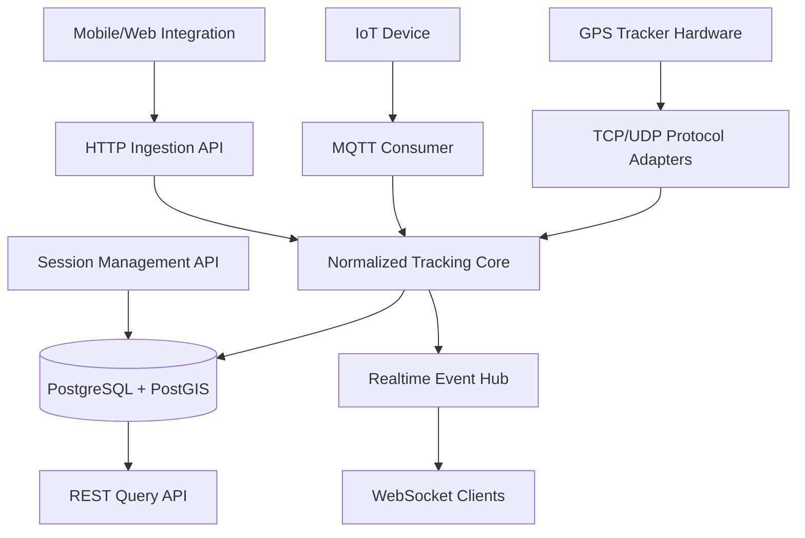

# Generic GPS Tracking Backend — Application Summary

> **Status:** FINAL — Perencanaan MVP v1.0 (19 Oktober 2026). Final sebagai acuan implementasi; bukan klaim implementasi selesai atau siap produksi.
> **Bahasa utama implementasi:** Rust  
> **Jenis aplikasi:** Backend tracking berbasis API dan portal web management  
> **Prinsip desain:** Generic, protocol-agnostic, session-based, extensible

## 1. Ringkasan

**Generic GPS Tracking Backend** adalah layanan independen untuk menerima, memvalidasi, menyimpan, dan menyediakan data lokasi GPS secara real-time maupun historis. Layanan ini **tidak bergantung pada konteks bisnis** seperti armada, kendaraan, driver, kurir, atau aset tertentu.

Objek yang dilacak disebut **target**. Lokasi diterima dari **device**, yang dapat berupa GPS tracker hardware, aplikasi mobile, atau perangkat IoT. Periode ketika device diasosiasikan dengan target disebut **tracking session**.

Sistem dirancang untuk menerima data melalui beberapa protokol dan mengonversinya ke satu format internal agar pemrosesan, penyimpanan, dan akses data tetap konsisten.

## 2. Tujuan

- Menjadi backend GPS tracking yang dapat digunakan ulang oleh berbagai aplikasi.
- Menerima koordinat dari aplikasi maupun GPS tracker hardware komersial.
- Menyediakan pelacakan berbasis sesi tanpa memaksa hardware mendukung perintah `start`/`stop` session.
- Mendukung lokasi terkini, riwayat posisi, dan streaming pembaruan real-time.
- Memisahkan protokol komunikasi perangkat dari domain dan business logic inti.
- Mudah menambah dukungan protokol baru tanpa mengubah tracking core.
- Menjaga keamanan, integritas data, dan privasi lokasi sejak MVP.

## 3. Batasan Ruang Lingkup

### Termasuk dalam MVP

- Portal management untuk tim: akun/izin, target/device/session, provisioning token, peta live, histori dan audit. Lihat [Portal Spec](./gps-tracking-portal-spec.md).

- Multi-organisasi sejak awal, dengan tenant boundary pada semua data dan API.
- Akun dan login internal untuk management, membership, peran dan pembatasan akses objek; kredensial device terpisah.
- Retensi posisi satu tahun kalender sejak `recorded_at`, filter data kedaluwarsa dan purge worker otomatis.

- Registrasi dan manajemen target serta device.
- Identifikasi device dan autentikasi/otorisasi sesuai jenis koneksi.
- Start/end tracking session.
- HTTP/JSON ingestion untuk integrasi awal dan simulasi GPS.
- Penyimpanan koordinat dan pencarian riwayat berbasis waktu.
- Endpoint lokasi terakhir dan WebSocket untuk monitoring real-time.
- Heartbeat HTTP terautentikasi tanpa koordinat; kontak terakhir terpisah dari usia lokasi dan status tracking session.
- Validasi koordinat, timestamp, deduplikasi, dan penanganan data terlambat.
- Audit dasar, observability, dan konfigurasi retensi data.

### Di luar MVP

- Aplikasi driver dan dashboard analitik kustom.
- Modul khusus kendaraan, armada, driver, atau operasional organisasi.
- Route optimization, dispatch, geofencing lanjutan, dan analisis perilaku berkendara.
- Dukungan terhadap seluruh merek/protokol GPS tracker sekaligus.
- Kontrol jarak jauh perangkat (remote command), kecuali kelak diperlukan untuk protokol tertentu.
- Arsitektur microservices atau message broker kompleks tanpa kebutuhan beban nyata.

## 4. Domain Model

| Entitas | Tanggung jawab | Atribut penting |
|---|---|---|
| `targets` | Objek abstrak yang sedang dilacak | `id`, `name`, `external_ref`, `metadata` |
| `devices` | Sumber data GPS | `id`, `name`, `protocol`, `identifier`, `metadata` |
| `tracking_sessions` | Relasi target–device dalam interval waktu | `id`, `target_id`, `device_id`, `started_at`, `ended_at` |
| `positions` | Data GPS mentah yang sudah dinormalisasi | `id`, `device_id`, `location`, `recorded_at`, `received_at`, `attributes` |

**Aturan utama:**

1. **Target ≠ device.** Target adalah hal yang dilacak; device adalah sumber koordinat.
2. Sebuah target dapat berganti device pada sesi berikutnya.
3. Sebuah device dapat digunakan target berbeda pada sesi yang tidak bertabrakan.
4. Pada MVP, satu target dan satu device masing-masing hanya boleh memiliki **satu sesi aktif**.
5. `positions` direlasikan secara permanen dengan **device**, sedangkan relasi ke session ditentukan melalui device dan rentang waktu sesi (`recorded_at`).
6. Untuk query riwayat yang benar, backend juga perlu mencegah *overlap* rentang sesi historis bagi device yang sama, bukan hanya melarang dua sesi aktif bersamaan.

## 5. Alur Kerja Utama

### A. Registrasi

1. Klien mendaftarkan **target** (contoh: `Operasional A`).
2. Klien mendaftarkan **device** dan protokol/identifier yang digunakan (contoh: `GPS-001`).
3. Server menyimpan identitas device, konfigurasi, dan kredensial/aturan aksesnya.

### B. Memulai session

1. Klien memanggil `POST /v1/sessions` dengan `target_id` dan `device_id`.
2. Backend memeriksa izin dan memastikan target/device tidak sedang berada dalam sesi aktif yang bertentangan.
3. Backend membuat session dengan waktu mulai yang ditetapkan server.
4. **Session tidak harus mengirim perintah ke hardware.** Hardware boleh terus mengirim data secara mandiri.

### C. GPS ingestion

1. Data diterima oleh adapter HTTP, MQTT, atau hardware TCP/UDP.
2. Adapter memvalidasi identitas sumber, membaca payload, lalu mengonversinya ke model posisi internal yang konsisten.
3. Tracking core memvalidasi koordinat, akurasi, timestamp, dan identitas/duplikasi pesan.
4. Backend menerapkan kebijakan penyimpanan (`session_only` atau `always`).
5. Data disimpan secara idempotent di PostgreSQL/PostGIS.
6. Setelah penyimpanan berhasil, lokasi terakhir yang valid diperbarui dan event real-time diterbitkan.
7. ACK protokol hardware dikirim sesuai spesifikasi adapter dan semantik penerimaan datanya.

### D. Mengakhiri session

1. Klien memanggil `POST /v1/sessions/{id}/end`.
2. Backend menetapkan `ended_at` dan menutup sesi secara konsisten.
3. Posisi di luar interval sesi tidak lagi masuk riwayat target tersebut, meskipun hardware tetap mengirimkan koordinat.

### E. Koneksi terputus dan data terlambat

- `recorded_at` = waktu GPS merekam posisi; `received_at` = waktu backend menerima data.
- Backend mendukung retry/batch dari aplikasi, serta buffer hardware bila protokol mendukung.
- Data terlambat boleh diasosiasikan dengan sesi berdasarkan `recorded_at`, selama kebijakan retensi dan toleransi keterlambatan mengizinkan.
- Posisi lama yang diterima belakangan **tidak boleh menimpa posisi live yang lebih baru**.
- `session active` tidak sama dengan `device online`; status konektivitas perlu dikelola terpisah.

## 6. Arsitektur Sistem



### Komponen

- **Protocol Adapters:** menerima/men-decode payload dari berbagai transport dan protokol hardware.
- **Tracking Core:** normalisasi, validasi, aturan retensi, deduplikasi, dan pemrosesan posisi.
- **Session Service:** mengelola penugasan target–device berdasarkan waktu.
- **Storage Layer:** PostgreSQL/PostGIS untuk domain dan data geospasial.
- **Realtime Hub:** menyebarkan pembaruan GPS lewat WebSocket.
- **Query API:** menyediakan lokasi terakhir, sesi, dan riwayat posisi.

**Pola deployment awal:** modular monolith dalam satu aplikasi server Rust. Broker/Redis dan pemisahan service baru dipertimbangkan ketika jumlah koneksi, throughput, atau skala horizontal benar-benar membutuhkan.

## 7. Protokol dan Kompatibilitas Hardware

| Jenis | Dukungan yang direncanakan | Catatan |
|---|---|---|
| HTTP/HTTPS + JSON | **MVP (wajib)** | Kontrak ingestion publik milik aplikasi; mudah diuji |
| MQTT 3.1.1 / 5.0 | Fase berikutnya | Standar transport IoT; **payload lokasi tetap perlu disepakati** |
| GT06 family | Adapter hardware pertama (kandidat) | Protokol TCP binary, detail berbeda antarmodel/firmware |
| Teltonika Codec 8/8E | Adapter berikutnya | Perlu framing, identifikasi device, dan ACK spesifik |
| NMEA 0183 | Opsional | Format data navigasi; bukan jaminan konektivitas IP perangkat |
| JT/T 808 | Opsional | Berdasarkan perangkat yang benar-benar digunakan |

> **Prinsip:** Tidak ada satu protokol GPS internet yang otomatis didukung semua tracker. **MQTT adalah standar messaging, bukan standar universal payload GPS.** Setiap hardware yang berbeda mungkin memerlukan decoder dan respons ACK khusus.

### Kontrak internal posisi (contoh)

```json
{
  "device_identifier": "GPS-001",
  "protocol": "http-json",
  "position": {
    "latitude": -6.8048,
    "longitude": 110.8419,
    "altitude_m": null,
    "speed_mps": 9.5,
    "heading_deg": 135.0,
    "accuracy_m": 8.5,
    "recorded_at": "2026-10-19T03:00:10Z"
  },
  "attributes": {
    "battery_percent": 86,
    "satellites": 12
  }
}
```

Data umum disimpan pada field terstruktur; metadata vendor-spesifik berada pada `attributes`. Format di atas merupakan **representasi internal**, bukan payload wajib untuk semua hardware.

## 8. API Tracking MVP

| Method | Endpoint | Fungsi |
|---|---|---|
| `POST` | `/v1/targets` | Registrasi target |
| `GET` | `/v1/targets` | Daftar target |
| `GET` | `/v1/targets/{id}/location` | Lokasi terbaru target dalam konteks sesi |
| `POST` | `/v1/devices` | Registrasi device |
| `GET` | `/v1/devices` | Daftar device |
| `GET` | `/v1/devices/{id}/positions` | Riwayat lokasi device |
| `POST` | `/v1/sessions` | Mulai tracking session |
| `POST` | `/v1/sessions/{id}/end` | Akhiri session |
| `GET` | `/v1/sessions/{id}/positions` | Riwayat lokasi dalam interval session |
| `POST` | `/v1/ingest/positions` | Ingestion lokasi HTTP (termasuk batch) |
| `GET` | `/v1/ws/tracking` | Pembaruan lokasi real-time |

Catatan: endpoint ingestion memakai autentikasi device/credential khusus; endpoint administratif dan WebSocket memakai otorisasi pengguna/aplikasi. Driver atau konsep bisnis eksternal **tidak disimpan sebagai requirement domain** tracking core.

### Konvensi MQTT (bukan standar payload global)

```text
tracking/v1/devices/{device_id}/positions
```

## 9. Penyimpanan, Retensi, dan Integritas

- Database: **PostgreSQL + PostGIS**.
- Koordinat geospasial: `GEOGRAPHY(Point, 4326)`; urutan konstruksi titik adalah **longitude, latitude**.
- Indeks utama: `(device_id, recorded_at DESC)`; indeks spasial ditambahkan untuk query lokasi spasial.
- Deduplikasi: gunakan `message_id`/ID sumber jika tersedia. Device legacy yang tidak memiliki ID pesan memerlukan strategi *best effort* berdasarkan karakteristik protokol; tidak semua duplikasi dapat dihilangkan sempurna.
- `session_only` (default disepakati): simpan hanya titik yang termasuk sesi yang valid, memperhitungkan data terlambat yang diizinkan.
- `always` (opsional, diaktifkan admin secara eksplisit dan diaudit): simpan lokasi device meskipun tidak ada sesi.
- Gunakan transaksi/locking database untuk menghindari race antara stop session dan GPS ingestion.
- Retensi posisi: satu tahun kalender sejak `recorded_at`; query mengecualikan posisi kedaluwarsa dan worker menghapus bertahap minimal setiap jam. Retensi backup recovery window 30 hari (dependency max 37 hari), audit 365 hari; lihat Database & Operations.
- Late-arrival maksimal 24 jam. Clock maju maksimal 2 menit: pada `session_only`, titik masa depan diminta retry (`TIMESTAMP_NOT_READY`) setelah waktu rekam tercapai, lalu interval sesi diperiksa kembali. Lebih dari 2 menit ditolak. Tidak mengubah waktu sumber.
- Retry identik dikenali sebelum evaluasi ulang usia/policy jika pesan masih tersimpan; tidak memperpanjang retensi.

### 9.1 Skala awal

Penggunaan awal oleh pemilik proyek: 2 organisasi dan sekitar 100 device total (asumsi total lintas organisasi). Distribusi device belum ditetapkan. Pengiriman posisi adaptif berdasarkan pergerakan, tanpa interval tetap; backend tidak mengimplementasikan algoritma movement client. Sizing retensi satu tahun memakai volume harian dan peak/burst terukur; skenario interval tetap pada App Spec §14.0 hanya pembanding sintetis. Device diam tidak otomatis berarti offline; heartbeat tanpa koordinat dan pemisahan konektivitas dari freshness sudah masuk MVP. Default disepakati: heartbeat 60 detik jika tidak ada ingestion yang berhasil, timeout offline 180 detik tanpa kontak; keduanya konfigurabel.

## 10. Rekomendasi Tech Stack

Frontend portal dipilih: React + Vite, Tailwind CSS dan shadcn/ui, dalam satu repository dengan Rust. Rekomendasi library pendukung: [Frontend Stack](./gps-tracking-frontend-stack.md).

| Bagian | Teknologi |
|---|---|
| Language | Rust (stable) |
| REST API / WebSocket | Axum |
| Async runtime | Tokio |
| Database access | SQLx |
| Database | PostgreSQL |
| Spatial extension | PostGIS |
| Serialization | Serde / serde_json |
| Timestamp | chrono |
| ID | uuid |
| Structured logging | tracing |
| TCP packet framing | tokio-util codec (bila sesuai protokol) |
| MQTT consumer | rumqttc (bila diimplementasikan) |
| Testing | Unit, integration, dan protocol fixture tests |

## 11. Usulan Struktur Repository

```text
gps-tracking/
├── Cargo.toml
├── crates/
│   ├── tracking-core/       # Posisi, session, validasi, aturan domain
│   ├── tracking-protocols/  # Adapter GT06, Teltonika, dst.
│   ├── tracking-storage/    # Repository SQLx dan geospatial queries
│   └── tracking-realtime/   # Event hub / websocket
├── apps/
│   └── server/              # HTTP, MQTT consumer, TCP/UDP listeners
├── migrations/
└── tests/
```

Menggunakan Cargo Workspace **tidak berarti** harus memakai microservices; aplikasi tetap dapat dijalankan sebagai satu binary.

## 12. Keamanan dan Privasi

- Login management menggunakan email/password; undangan/reset melalui tautan email sekali pakai.
- MFA wajib untuk pengelola platform, admin organisasi dan operator yang boleh menerbitkan/merotasi token device; opsional bagi pengguna lain. Metode MFA TOTP; cookie sesi HttpOnly + CSRF untuk portal.
- Recovery codes sekali pakai dan manajemen/pencabutan sesi login perangkat lain termasuk MVP. Reset password tidak mematikan MFA. Rincian mengikuti [Portal Spec §3.2](./gps-tracking-portal-spec.md).

- HTTPS/TLS untuk HTTP dan MQTT jika didukung perangkat.
- Identitas device (misalnya IMEI) **bukan credential rahasia** dan tidak cukup untuk autentikasi sendiri.
- Autentikasi untuk device dan authorization untuk pengguna/API client dipisahkan.
- `tenant_id` wajib sejak MVP. Akses posisi/sesi memerlukan membership aktif dan izin objek; target, device, dan session terkait wajib satu organisasi. Transfer antarorganisasi belum didukung.
- Berikan audit log akses data sensitif dan aksi pembuatan/penutupan sesi.
- Batasi durasi penyimpanan koordinat di luar sesi berdasarkan kebijakan yang jelas.
- Perangkat legacy TCP tanpa keamanan transport memerlukan kontrol jaringan tambahan serta evaluasi ancaman yang realistis.

## 13. Tahapan Implementasi

| Fase | Deliverable |
|---|---|
| **1. Foundation** | Cargo workspace, Axum, config, PostgreSQL/PostGIS, SQLx migrations, logging |
| **2. Domain & Auth** | Akun/login internal, organisasi, membership, izin objek, target, device, tracking session, constraints |
| **3. HTTP Ingestion** | Endpoint batch GPS, autentikasi sumber, deduplikasi, riwayat |
| **4. Realtime** | Last-known position, heartbeat, konektivitas/freshness terpisah, WebSocket |
| **4P. Portal Management** | Login/tim, target/device/session, provisioning, peta, histori dan audit; AC-PORT-01..09 |
| **5. MQTT** | Consumer, topic convention, auth, QoS/retry strategy |
| **6. Hardware Adapter** | Implementasi dan pengujian paket GT06 atau perangkat nyata yang dipilih |
| **7. Hardening** | Concurrency tests, observability, retention, load testing, deployment |

## 14. Baseline yang disepakati

- Tracking engine generic; target, device, tracking session, dan position tetap masuk MVP.
- HTTP/JSON pertama; MQTT dan hardware berada pada fase berikutnya.
- Rust, PostgreSQL/PostGIS, dan modular monolith.
- Banyak organisasi sejak MVP; tenant boundary, akun/login internal management, peran dan izin objek wajib.
- Pengelola platform membuat organisasi/admin awal; admin mengundang anggota. Tidak ada registrasi publik. Akun dapat bergabung ke beberapa organisasi dengan konteks aktif yang jelas; pengelola platform tidak otomatis dapat membaca lokasi.
- Default `session_only`; `always` membutuhkan perubahan eksplisit oleh admin yang diaudit.
- Retensi posisi satu tahun kalender, late-arrival 24 jam, toleransi clock maju 2 menit dengan retry sebelum penyimpanan `session_only`.
- Portal management masuk MVP proyek ini, termasuk registrasi device dan token untuk client, peta serta histori. Admin/operator/viewer mengikuti matriks izin Portal Spec.

**Langkah berikutnya:** ikuti [Implementation Plan](./gps-tracking-implementation-plan.md). Keputusan teknis, management API dan database/operasional sudah ditetapkan; migrations, OpenAPI dan pengujian diwujudkan saat implementasi.

---

**Inti rancangan:** *One generic tracking core, multiple protocol adapters, session-based association, and one consistent geospatial API.*
